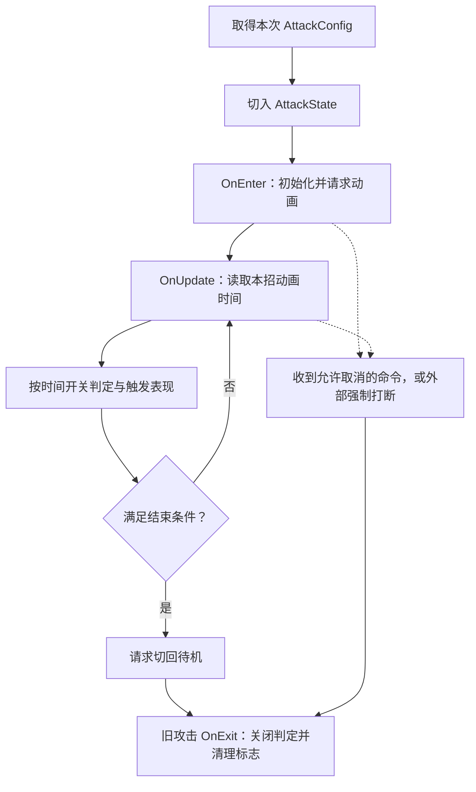

## 1. 进入攻击状态以后，这一刀还要做什么？

玩家按下攻击后，上一章的输入与 HFSM 已经解决了“现在能不能出招、切到哪个状态”。这一章接着看：角色已经进入攻击状态，程序怎样让这一刀从抬手走到收招。

把画面中的动作拆开，就会看到几个连续的问题：

1. 刚开始抬手，应该播放哪段动画，使用多少伤害？
2. 刀还没有挥到有效位置时，怎样保持判定关闭？
3. 刀挥出去以后，怎样开启检测，又避免连续几帧反复打中同一人？
4. 收招期间，什么时候可以闪避、防御或者接下一刀？
5. 如果中途被弹开，谁负责关闭还在运行的攻击判定？

这些事情分别落在“进入、更新、退出”三个阶段。本章先说明谁负责，再跟着一刀看数据怎样变化。物理扫描如何找到敌人、命中后如何裁决防御，留给下一章。

### 1.1 先认识三个主要角色

| 类型 | 负责什么 | 在一次攻击中的位置 |
| --- | --- | --- |
| `AttackConfig` | 保存动画名、伤害、时间窗口和下一段配置 | 提供这一招的规则 |
| `AttackStateBase` | 实现攻击进入、逐帧更新、退出以及命令处理的公共逻辑 | 读取规则并执行 |
| `AttackState` | 决定地面攻击结束后的去向，以及地面取消、移动与连招状态的创建 | 补充地面动作的具体处理 |

配置中写了“0.23 秒开启判定”，不会自动在那个时刻执行。需要攻击状态不断读取动画时间，再根据配置调用武器接口。

攻击类的继承关系如下：

```text
BaseState
└─ AttackStateBase
   ├─ AttackState：地面攻击
   └─ AirAttackState：空中攻击
```

`AttackStateBase` 继承 `BaseState`，重写了 `OnEnter`、`OnUpdate`、`OnExit` 和 `HandleCommand`。地面子类 `AttackState` 没有再次重写这些方法，因此状态机调用地面攻击对象时，直接执行 `AttackStateBase` 的实现。

父类执行公共流程，也会调用留给子类的钩子。例如父类判断动作结束后调用 `ExitToIdle()`，地面子类负责切回地面待机。后文会把这两部分接起来。

### 1.2 先记住执行顺序



图中的取消是另一条入口：输入系统发送命令时调用 `HandleCommand`，并非 `OnUpdate` 自己去读取按键。

## 2. 这一刀的规则从哪里来？

这一节先回答“状态拿到了什么数据”。用当前 `atk1` 资产作为例子，后面的通用代码仍然可以执行其他招式。

### 2.1 选择配置，再交给攻击对象

待机状态收到攻击命令后，会调用 `body.GetAttackConfig()` 取得本次配置，再创建 `AttackState` 并交给地面子状态机切换。配置入口的完整实现是：

```csharp
public AttackConfig GetAttackConfig()
{
    return ActiveAttack != null ? ActiveAttack : LightAttack;
}
```

`ActiveAttack` 表示为下一次攻击临时指定的配置；没有指定时，使用角色的 `LightAttack`。例如普通轻击可使用默认配置，长按突刺则由输入逻辑预先指定另一份配置。

地面攻击的构造函数把角色、所属父状态和配置继续交给攻击基类：

```csharp
public AttackState(CharacterBody body, HierarchicalState parent, AttackConfig config)
    : base(body, parent, config)
{
}
```

```csharp
protected AttackStateBase(CharacterBody body, HierarchicalState parent, AttackConfig config) : base(body)
{
    this.parent = parent;
    this.config = config;
}
```

这里的三个参数分别是：

- `body`：这次正在出招的角色，后续通过它访问动画、朝向和武器。
- `parent`：所属的地面父状态，后续通过它切换地面子动作。
- `config`：本次招式的配置引用，后续所有窗口判断都围绕它进行。

构造函数只保存这些关系。真正开始动作，要等状态机调用 `OnEnter()`。

### 2.2 把配置翻译成画面中的时刻

当前 `atk1` 资产中与本章相关的字段如下，表内数值已按当前资产核对。

| 字段 | 值 | 在这一刀里表示什么 |
| --- | --- | --- |
| `AnimName` | `Attack1` | 请求播放的动画状态名 |
| `BaseDamage` | `10` | 默认生命伤害 |
| `PostureDamage` | `5` | 默认架势伤害 |
| `HitStartTime` | `0.23` | 前摇取消阶段的结束点 |
| `RecoveryWindowStart` | `0.50` | 后摇取消和连招窗口的起点 |
| `ComboWindowEnd` | `0.66` | 接下一段攻击的截止点 |
| `StateDuration` | `1.467` | 本招用于时长退出判断的门槛 |
| `NextCombo` | 非空配置引用 | 满足连招条件时使用的下一招 |
| `hitPulses[0]` | `start = 0.23, end = 0.50` | 本招唯一的近战判定区间 |
| `overrideCombat` | `false` | 此脉冲沿用进招时保存的默认数值 |

这些秒数都相对于本招动画起点。它们不是全局的 `Time.time`。

资产没有序列化 `WaitAnimEnd` 字段，代码中该布尔字段没有设为 `true` 的初始值，本章按其默认值 `false` 分析；这不是运行时 Inspector 截图验证。

### 2.3 先分清三种窗口

| 动画内时间 | 近战判定 | 闪避、防御取消 | 接下一刀 |
| --- | --- | --- | --- |
| `0 ≤ t < 0.23` | 关闭 | 允许 | 不允许 |
| `0.23 ≤ t < 0.50` | 开启 | 不允许 | 不允许 |
| `0.50 ≤ t ≤ 0.66` | 关闭 | 允许 | 有下一招且收到攻击命令时允许 |
| `0.66 < t < 1.467` | 关闭 | 仍然允许 | 不允许 |

这张表以角色仍处于本次地面攻击、没有其他全局拦截为前提。“允许”表示状态愿意处理相应命令，不表示自动执行该动作。

这里容易混淆的是：

**武器是否能检测命中、玩家能否取消动作、能否接下一刀，是三套判断。**

运行时，近战开关直接读取 `hitPulses`；闪避和防御读取前摇、后摇门槛；连招还要检查 `NextCombo` 与截止时间。因此过了 `0.66` 秒，只是不能再接下一刀，闪避和防御取消不会因此重新关闭。

当前资产的脉冲起止恰好与节奏门槛对齐。编辑配置时，`AttackConfig.OnValidate` 还会用首末脉冲同步这两个门槛；所以“运行时使用不同字段判断”不等于“配置工具完全不关联这些字段”。

## 3. 谁把攻击状态一帧一帧推动起来？

这一节把上一章的 HFSM 接到攻击逻辑上。先看驱动关系，再进入攻击方法内部。

### 3.1 继承关系决定最终执行哪个方法

`GroundedState` 继承 `HierarchicalState`，并重写 `OnUpdate()`。它先判断是否要离开地面，仍留在地面时，显式调用 `base.OnUpdate()`。

`AttackState` 继承 `AttackStateBase`，没有重写 `OnUpdate()`。地面子状态机更新这个攻击对象时，直接执行父类的攻击更新。

```text
Unity 每帧调用
└─ CharacterBody.Update()
   └─ MainStateMachine.Update()
      └─ GroundedState.OnUpdate()
         ├─ 满足离地条件：切入空中并 return
         └─ 否则 base.OnUpdate()
            即 HierarchicalState.OnUpdate()
            └─ SubStateMachine.Update()
               └─ 当前 AttackState 对象的 OnUpdate()
                  实际执行 AttackStateBase.OnUpdate()
```

### 3.2 把转发代码连起来

`CharacterBody` 是 MonoBehaviour，由 Unity 调用它的 `Update()`：

```csharp
private void Update()
{
    // 先更新接地等环境信息，状态机本帧读取同一份结果。
    UpdateEnvironmentalChecks();

    // 坠出地图时传回最近安全点。
    UpdateFallSafety();

    // 2. 架势自然回复（只狼：一段时间不受击就缓慢回架势）
    UpdatePostureDecay();

    // 3. 驱动主状态机运行 (主状态机会自动一层层往下驱动子状态机)
    MainStateMachine.Update();
}
```

这里只要抓住顺序：先更新角色的环境与数值信息，再让主状态机更新当前状态。

顶层和子层使用同一个 `StateMachine` 类型，更新方法都是：

```csharp
public void Update()
{
    CurrentState?.OnUpdate();
}
```

但两台状态机是不同对象。此时顶层的 `CurrentState` 是 `GroundedState`，地面子层的 `CurrentState` 才是 `AttackState`。

地面父状态先处理是否离开地面：

```csharp
public override void OnUpdate()
{
    // 踩空掉落。Boss 不进空中状态（Config.UseAirState = false）。
    // 被弹开硬直（含 Deflected_Boat）不能因根运动短暂离地被切走。
    if (!body.IsGrounded && !body.IsPostureBroken && !body.IsParried && !body.IsFinisherLocked && body.UsesAirState)
    {
        body.EnterAirborne("grounded: left ground");
        return;
    }

    base.OnUpdate(); // 更新当前子状态，包含待机、移动、攻击等。
}
```

如果走到 `base.OnUpdate()`，执行的是 `HierarchicalState` 的实现：

```csharp
public override void OnUpdate()
{
    // 如果父状态自己没被切走，就驱动当前的子状态更新
    SubStateMachine.Update();
}
```

于是进入地面子状态机，再调用当前攻击对象的更新方法。攻击更新依靠这条调用链持续执行；普通 C# 状态对象本身不会收到 Unity 自动派发的 `Update`。

## 4. 进入攻击时，先准备哪些东西？

这一节走“进入一次攻击”的完整切片，停在初始化完成。

### 4.1 OnEnter 是谁调用的？

`AttackState` 没有重写 `OnEnter()`，所以切入它时直接执行 `AttackStateBase.OnEnter()`。

以玩家从待机出招为例，入口与逐帧更新是两条不同的链：

```text
Unity 调用 PlayerBrain.Update()
└─ base.Update()，即 BrainBase.Update()
   └─ ProcessCommandBuffer()
      └─ CharacterBody.TryExecuteCommand(AttackCommand)
         └─ MainStateMachine.HandleCommand()
            └─ GroundedState 继承的 HierarchicalState.HandleCommand()
               ├─ 父层检查，没有拦截本次普通攻击
               └─ SubStateMachine.HandleCommand()
                  └─ IdleState.HandleCommand()
                     └─ 取得配置并创建 AttackState
                        └─ SubStateMachine.ChangeState()
                           ├─ 旧状态 OnExit()
                           ├─ CurrentState = 新攻击对象
                           └─ 新状态 OnEnter()
                              实际执行 AttackStateBase.OnEnter()
```

这里假设输入门禁允许操作，且没有处决机会等分支吞掉普通攻击。输入如何进入缓冲已经在前章展开；本章从缓冲中的命令被接受接续。

`StateMachine.ChangeState()` 的完整实现如下。阅读时先看退出旧状态、替换引用、进入新状态，其余字段是在记录调试信息。

```csharp
public void ChangeState(BaseState newState, string reason = null)
{
    BaseState previous = CurrentState;
    // 先保存旧路径，再执行 OnExit。父状态的 OnExit 会清空子状态机，
    // 不能等退出后再通过对象反推完整路径。
    PreviousStatePath = ResolveDebugPath(previous);
    previous?.OnExit();
    PreviousState = previous;
    CurrentState = newState;
    LastChangeReason = string.IsNullOrEmpty(reason) ? "unspecified" : reason;
    // 父状态会在 OnEnter 中建立初始子状态，之后再记录完整调试路径。
    CurrentState?.OnEnter();
    CurrentStatePath = ResolveDebugPath(CurrentState);
    TransitionCount++;
    onStateChanged?.Invoke(previous, CurrentState, LastChangeReason);
}
```

**创建对象与进入状态是两个步骤。** 构造函数保存参数；`ChangeState` 才负责把它设为当前状态并调用进入逻辑。

### 4.2 先看 OnEnter 做事的顺序

`OnEnter` 先重置本招的运行记录，保存基础伤害，消费一次性配置选择；校验通过后请求动画、设置朝向、计算初始判定，最后设置招式标志。

```csharp
public override void OnEnter()
{
    OnAttackEnter();

    animTime = 0f;
    sfxFired = null;
    arrowFired = null;
    body.IsAttackRecoveryOpen = false;
    fallbackDamage = config.BaseDamage;
    fallbackPosture = config.PostureDamage;
    fallbackKnockback = config.Knockback;
    fallbackGrade = config.HitGrade;
    moveEntry = body.CurrentMoveEntry;
    moveWindow = body.CurrentMoveWindow;
    activePulseIndex = -1;

    // ActiveAttack 是 Brain 对“下一次攻击”的一次性选择，状态取得后立即清空。
    if (body.ActiveAttack == config)
    {
        body.ActiveAttack = null;
    }

    if (!ValidateWindows())
    {
        ExitToIdle();
        return;
    }

    // 统一请求攻击动画，JumpThrust 使用直接播放，其余招式使用融合。
    bool attackAnimStarted = AnimUtil.TryBeginAttackAnim(body.Animator, config, body.CurrentMoveEntry);
    if (!attackAnimStarted)
    {
        Debug.LogError($"{body.name} 的 Animator 缺少攻击状态：{config.AnimName}");
    }


    // 允许转向的招：起手先对准目标，整招丢掉 Clip 根旋转，否则挥砍 Root yaw 会盖掉代码朝向。
    // 识破冻结也在这里解开：下一刀才允许再转向玩家。
    body.ClearCombatYawFrozen();
    body.SetSuppressRootYaw(config.AllowRotation);
    if (config.AllowRotation)
    {
        SnapTowardCombatTarget();
        UpdateAttackSteer();
    }

    // 判定只跟随 hitPulses 的有效近战时间段；HitStartTime 不直接开启 Hitbox。
    weaponHitEnabled = false;
    ApplyHitbox();

    body.AttackUninterruptible = IsUninterruptibleAttack(config, body.CurrentMoveEntry);

    // 危字攻击：发事件 → UI 弹"危"字提示
    if (config.Perilous != PerilousType.None)
    {
        CombatEventBus.TriggerPerilousAttack(config.Perilous);
    }
}
```

### 4.3 把这些初始化动作放回同一场景

假设这次拿到的是 `atk1`。

首先，`OnAttackEnter()` 是提供给子类的进入钩子。地面子类没有重写它，执行基类空实现：

```csharp
protected virtual void OnAttackEnter() { }
```

然后把 `animTime` 设为 `0`，表示本招尚未推进。音效和出箭的触发记录清空，`activePulseIndex = -1` 表示还没有记住一个已开启的脉冲。

`fallbackDamage` 等字段保存进招时的基础数值。当前例子保存伤害 `10`、架势伤害 `5`。后面某个脉冲可能覆盖伤害，没有覆盖的脉冲需要能够回到这份基础值。

`moveEntry` 与 `moveWindow` 保存当前 Boss 招式上下文，供共用逻辑后续使用；普通轻击理解到“基类也服务 Boss 攻击”即可，本章不展开出箭分支。

接下来，如果 `body.ActiveAttack` 恰好等于本次配置，就把这个一次性选择清空。**清空的是角色上的待用选择，攻击对象自己的 `config` 引用仍然存在。** 因此本次攻击能够继续读配置，同时避免后续动作重复消费旧选择。

校验通过后，`AnimUtil.TryBeginAttackAnim` 请求动画；普通攻击使用融合播放，特殊 `JumpThrust` 使用直接播放。返回成功表示发出了播放请求，不表示这一刻动画已经播放完毕。

朝向部分先解除之前的战斗朝向冻结，再根据 `AllowRotation` 控制根旋转抑制；允许转向时，对齐目标并更新攻击转向。攻击中的位移由动画根运动承担，这里不手动推进角色位置。

最后调用 `ApplyHitbox()`，并设置不可打断标记和危字提示。危字提示只有配置不是 `None` 时才会广播。

### 4.4 关键分支：配置错误与动画请求失败不是同一种处理

窗口校验的完整实现：

```csharp
private bool ValidateWindows()
{
    bool valid =
        config.HitStartTime >= 0f &&
        config.HitStartTime <= config.RecoveryWindowStart &&
        config.RecoveryWindowStart <= config.ComboWindowEnd &&
        config.ComboWindowEnd <= config.StateDuration &&
        config.RotationWindowEnd >= 0f &&
        config.RotationWindowEnd <= config.StateDuration;

    if (valid && HasHitPulses())
        valid = ValidateHitPulses();

    if (!valid)
    {
        Debug.LogError(
            $"{config.name}（Anim={config.AnimName}）的攻击窗口非法：" +
            $"HitStart={config.HitStartTime}, Recover={config.RecoveryWindowStart}, " +
            $"ComboEnd={config.ComboWindowEnd}, Duration={config.StateDuration}, " +
            $"RotateEnd={config.RotationWindowEnd}。" +
            "必须满足 0 <= HitStartTime <= RecoveryWindowStart <= ComboWindowEnd <= StateDuration，" +
            "且 RotationWindowEnd 位于动作时长内。多段判定的 start<end 且落在时长内。");
    }
    return valid;
}
```
```csharp
private bool HasHitPulses()
{
    return config.hitPulses != null && config.hitPulses.Length > 0;
}
```
```csharp
private bool ValidateHitPulses()
{
    HitPulse[] pulses = config.hitPulses;
    for (int i = 0; i < pulses.Length; i++)
    {
        HitPulse p = pulses[i];
        if (p == null) return false;
        if (p.start < 0f || p.end > config.StateDuration || p.start >= p.end)
            return false;
    }
    return true;
}
```

基本顺序允许相等：

```text
0 ≤ HitStartTime ≤ RecoveryWindowStart ≤ ComboWindowEnd ≤ StateDuration
0 ≤ RotationWindowEnd ≤ StateDuration
```

存在脉冲数组时，每项不能为 null，且要求 `0 ≤ start < end ≤ StateDuration`。这里校验区间是否合法；后面的有效近战判断还要求脉冲跨度至少为 `0.02` 秒。

校验失败会调用 `ExitToIdle()`，随后 `return`，不继续后面的动画与判定初始化。

而动画请求失败只打印错误，当前 `OnEnter` 没有立刻退回待机。不能把这段代码理解成“动画不存在也一定能自动安全结束”；如果时钟一直读不到目标动画，依赖它的退出条件也可能无法达到。

### 4.5 初始时间为 0，为什么这次没有开判定？

对 `atk1` 而言，脉冲从 `0.23` 开始，`animTime = 0` 不在区间内，所以初次 `ApplyHitbox()` 不会开启判定。

这里有两个边界：

- 如果另一招配置了从 `0` 开始的有效脉冲，初次调用就可以开启判定。
- `weaponHitEnabled = false` 是攻击状态内部的记账赋值，本身没有调用底层关闭接口。前一状态的清理仍然要由退出流程承担。

所以本例是“按配置计算后不需要开启”，不是“所有攻击首帧无条件强制关闭”。

## 5. 进入以后，每帧用什么时间推进这一刀？

这一节沿第 3 节的驱动链，进入 `AttackStateBase.OnUpdate()`。地面子类仍然没有重写这个方法。

### 5.1 先看更新方法的完整顺序

```csharp
public override void OnUpdate()
{
    // 空中刀落地由 AirState.LeaveAir 切回地面；落地帧不再推进本刀（地面恒 false）
    if (WantsImmediateLand) return;

    animTime = AttackAnimClock.ReadSeconds(body.Animator, config.AnimName);
    // 先取本招的动画时钟，再同步命中、音效、出箭；动画变速时这些节点一起跟随。
    body.IsAttackRecoveryOpen = animTime >= config.RecoveryWindowStart;

    ApplyHitbox();
    ApplySfx();
    ApplyArrows();

    if (config.AllowRotation)
    {
        UpdateAttackSteer();
    }

    // 位移不在此处理：突进/前移完全由攻击动画的 Root 曲线驱动（全权根运动），
    // 代码只负责状态时长与连招窗口判定

    // 按配置时长或动画结束退出；无连招动作播完且判定关闭后可提前结束，避免停在末帧。
    bool noMelee = !AttackWindowSync.CanMeleeHit(config.hitPulses);
    bool animFinished = IsAnimFinished(config.AnimName);
    bool animPlayedOut = config.NextCombo == null
        && animTime >= LastHitWindowEnd()
        && animFinished;
    if (config.WaitAnimEnd)
    {
        if (animFinished)
            ExitToIdle();
    }
    else if (animTime >= config.StateDuration || animPlayedOut || (noMelee && animFinished))
    {
        ExitToIdle();
    }
}
```

正常地面攻击中，`WantsImmediateLand` 使用基类的 `false`，不会走开头的提前返回。

后面的流程分成三段：

1. **读取时间**：从 Animator 取得本招的动画内秒数，并更新后摇开放标志。
2. **执行到点的事情**：更新近战判定、音效、出箭以及允许的转向。
3. **判断是否结束**：根据时长与动画完成情况决定要不要退出。

`ApplySfx` 和 `ApplyArrows` 也使用这里更新的 `animTime`。本章主要展开近战开关；这两个接口分别负责按各自 cue 触发音效和出箭，不参与本次轻击的脉冲选择。

### 5.2 animTime 不是从进入状态开始累计的现实秒数

`AttackAnimClock` 负责把目标动画状态的进度换成秒，供窗口判断使用。它的完整类实现如下：

```csharp
public static class AttackAnimClock
{
    public const int Layer = 0;

    public static float ReadSeconds(Animator animator, string animName)
    {
        int hash = Animator.StringToHash(animName);

        // 混合期间优先读目标状态，让新攻击从自己的动画时间开始推进。
        if (animator.IsInTransition(Layer))
        {
            AnimatorStateInfo next = animator.GetNextAnimatorStateInfo(Layer);
            if (next.shortNameHash == hash)
                return SecondsFrom(next);
        }

        AnimatorStateInfo current = animator.GetCurrentAnimatorStateInfo(Layer);
        if (current.shortNameHash == hash)
            return SecondsFrom(current);

        // 目标攻击尚未成为当前/下一动画时，从 0 等待；不借用上一动作的时间推进新招判定。
        return 0f;
    }

    static float SecondsFrom(AnimatorStateInfo info)
    {
        if (info.length <= 0.0001f)
            return 0f;
        // 归一化进度 × 状态长度，换算成攻击配置使用的动画内秒数；不是全局 Time.time。
        return info.normalizedTime * info.length;
    }
}
```

先看 `SecondsFrom`：

```text
动画内时间 = normalizedTime × 状态长度
```

例如长度为 `2`、归一化进度为 `0.25`，得到 `0.5` 秒。攻击代码用这个结果与配置中的 `0.23`、`0.50` 等门槛比较。

然后看 `ReadSeconds` 如何找到该读哪个状态：

1. Animator 正在过渡时，先检查下一状态是不是本招；匹配就读下一状态。
2. 没读到匹配的下一状态，再检查当前状态。
3. 两者都不匹配，返回 `0`。

例如角色正在从待机融合到 `Attack1`，旧待机动画可能已经播放很久。此时如果误读旧状态时间，新攻击可能直接越过自己的窗口。当前实现通过名字匹配，只使用目标攻击的进度。

这里的零表示“暂时没有读到目标状态的时间”，不能单凭这个返回值判断动画成功或失败。

### 5.3 逐帧查询窗口的实际边界

当前攻击的近战开关由代码读取动画时间并查询区间，退出清理由 `OnExit` 完成。理解当前实现不需要假设 Animation Event 必然会因掉帧丢事件，也不能把这里称为“任何帧率下都不会漏判”。

`CurrentPulseIndex` 查询的是本次采样时刻。如果时间从 `0.22` 直接跳到 `0.51`，两次都不在 `[0.23, 0.50)` 内，当前代码没有补走中间窗口的逻辑。

后续的武器空间扫掠解决的是已开启检测时的空间移动问题，不能替代一个根本没有被开启的时间窗口。这里依据源码说明边界，不把静态分析当作低帧率运行测试。

## 6. ApplyHitbox 怎样决定开、关和保持？

这一节回答本章的核心问题：时间已经读出来了，怎样把它变成武器开关？

调用入口有两个：

```text
进入攻击
└─ AttackStateBase.OnEnter()
   └─ ApplyHitbox()：按 animTime = 0 计算初始状态

每帧更新攻击
└─ 第 3 节的 CharacterBody → 主状态机 → 地面子状态机驱动链
   └─ AttackStateBase.OnUpdate()
      ├─ 读取 animTime
      └─ ApplyHitbox()：按本次时间更新判定
```

### 6.1 先回答“当前时间属于哪一段”

一个 `HitPulse` 表示一次近战判定区间。一段动画可以配置一个脉冲，也可以配置多个脉冲。

有效近战的共用判断如下，`MinMeleeHitSpan` 的值为 `0.02f`：

```csharp
public static bool CanMeleeHit(HitPulse[] pulses)
{
    if (pulses == null || pulses.Length == 0) return false;
    for (int i = 0; i < pulses.Length; i++)
    {
        HitPulse p = pulses[i];
        if (p == null) continue;
        if (p.end - p.start >= MinMeleeHitSpan)
            return true;
    }
    return false;
}
```
```csharp
public static bool PulseIsMelee(HitPulse p)
{
    return p != null && p.end - p.start >= MinMeleeHitSpan;
}
```

`CanMeleeHit` 回答整份配置是否至少有一个有效脉冲。`PulseIsMelee` 回答指定的单项是否有效。

随后，攻击状态用当前时间查找下标：

```csharp
private int CurrentPulseIndex()
{
    // 同一攻击动画可以有多刀；遍历寻找覆盖当前动画时刻的有效近战窗口。
    HitPulse[] pulses = config.hitPulses;
    if (pulses == null) return -1;
    for (int i = 0; i < pulses.Length; i++)
    {
        HitPulse p = pulses[i];
        if (!AttackWindowSync.PulseIsMelee(p)) continue;
        if (animTime >= p.start && animTime < p.end)
            return i;
    }
    return -1;
}
```

返回值分两种：

- `0、1、2……`：当前时间落入的有效脉冲下标。
- `-1`：当前没有命中任何有效脉冲。

区间使用 `[start, end)`：包含起点，不包含终点。因此 `atk1` 在 `0.23` 时属于脉冲 0，在 `0.50` 时已经不属于它。

如果配置了重叠区间，代码会返回数组里第一个匹配项，不会同时开启两个脉冲。

### 6.2 四个变量分成“本次计算”与“跨次记账”

| 变量 | 回答的问题 | 生命周期 |
| --- | --- | --- |
| `pulseIndex` | 现在落在哪个脉冲？ | 本次调用的局部变量 |
| `wantOn` | 按现在的时间，应该开启吗？ | 本次调用的局部变量 |
| `weaponHitEnabled` | 本攻击状态上次记住的是开启吗？ | 保存在攻击对象中 |
| `activePulseIndex` | 上次开启的是哪个脉冲？ | 保存在攻击对象中 |

前两个来自当前配置和时间，后两个用于记住此前执行过的开关动作。

`weaponHitEnabled` 并不是每次去底层 Hitbox 查询得到的实时状态。如果外部直接关闭武器，它不会自动变成 `false`。正常流程通过状态切换和退出清理保持协调。

### 6.3 先完整读一次，再代入数值

```csharp
private void ApplyHitbox()
{
    int pulseIndex = -1;
    bool wantOn = false;
    if (AttackWindowSync.CanMeleeHit(config.hitPulses))
    {
        pulseIndex = CurrentPulseIndex();
        wantOn = pulseIndex >= 0;
    }

    bool pulseChanged = wantOn && pulseIndex != activePulseIndex;
    if (wantOn && (!weaponHitEnabled || pulseChanged))
    {
        if (weaponHitEnabled)
            body.DisableWeaponHit();
        ApplyPulseCombat(pulseIndex);
        body.EnableWeaponHit(config);
        weaponHitEnabled = true;
        activePulseIndex = pulseIndex;
    }
    else if (!wantOn && weaponHitEnabled)
    {
        body.DisableWeaponHit();
        weaponHitEnabled = false;
        activePulseIndex = -1;
    }

    body.ActiveHitPulseIndex = wantOn ? pulseIndex : -1;
}
```

第一部分算出 `pulseIndex` 与 `wantOn`。

第二部分比较本次结果和已有记录：

- 现在应该开，而且以前没开：开启。
- 现在应该开，但换成另一个脉冲：旧的关掉，再按新脉冲开启。
- 现在不该开，但以前开着：关闭。
- 仍是同一个脉冲，或者持续处于窗口外：不重复切开关。

最后，`body.ActiveHitPulseIndex` 把当前有效脉冲编号公开给其他战斗逻辑。它与攻击对象内部的 `activePulseIndex` 是两个字段，分别承担对外状态与内部记账。

### 6.4 让同一刀连续走过几次调用

假设每次更新分别读到下表中的时间；这些是讲解用的采样点，不代表帧恰好落在这些小数上。

| animTime | 本次算出的结果 | 调用前的记录 | 这次执行什么 |
| --- | --- | --- | --- |
| `0.00` | `pulseIndex=-1, wantOn=false` | 关闭，编号 -1 | 不开判定 |
| `0.24` | `pulseIndex=0, wantOn=true` | 关闭，编号 -1 | 装载伤害、开启，记为 true / 0 |
| `0.30` | `pulseIndex=0, wantOn=true` | 开启，编号 0 | 保持现状 |
| `0.51` | `pulseIndex=-1, wantOn=false` | 开启，编号 0 | 关闭，记为 false / -1 |
| `0.60` | `pulseIndex=-1, wantOn=false` | 关闭，编号 -1 | 继续保持关闭 |

在 `0.30` 秒这一行，`wantOn` 为真，但 `weaponHitEnabled` 已经为真，脉冲也没变。因此不会再次进入开启分支。

**持续处于判定区间，只需要保持开启，不需要每帧重新开启。**

### 6.5 为什么还需要 pulseChanged？

考虑一份用于说明的双脉冲配置：

```text
脉冲 0：[0.23, 0.35)
脉冲 1：[0.35, 0.50)
```

上一帧时间 `0.34`，本帧 `0.36`，两帧的 `wantOn` 都为真。如果只看开关，程序会以为无需处理；但这已经是第二次打击，需要装载第二段伤害并允许再次命中同一目标。

因此还要比较下标：

```text
pulseIndex = 1
activePulseIndex = 0
pulseChanged = true
```

程序先关闭旧判定，再装载新段伤害并开启，最后把 `activePulseIndex` 改成 `1`。

同理，两段之间虽然有间隔，但采样从上一段直接跳进下一段时，下标变化仍能触发重开。这不等于能够补算一个被完全跳过的脉冲。

## 7. “开启武器”究竟改变了什么？

上一节解决什么时候调用接口。这一节只向下跟到“绑定配置、开启扫描、重置去重记录”，不展开几何检测和攻防裁决。

### 7.1 开启前，先确定这段使用的伤害

攻击状态先调用：

```csharp
private void ApplyPulseCombat(int pulseIndex)
{
    HitPulse pulse = null;
    if (HasHitPulses() && pulseIndex >= 0 && pulseIndex < config.hitPulses.Length)
        pulse = config.hitPulses[pulseIndex];
    AttackCombatResolve.ApplyPulse(
        config, pulse, fallbackDamage, fallbackPosture, fallbackKnockback, fallbackGrade);
}
```

这里选出当前脉冲，再把进招时保存的基础数值交给 `AttackCombatResolve.ApplyPulse`：

```csharp
public static void ApplyPulse(
    AttackConfig cfg,
    HitPulse pulse,
    int fallbackDamage,
    float fallbackPosture,
    float fallbackKnockback,
    HitGrade fallbackGrade)
{
    if (pulse != null && pulse.overrideCombat)
    {
        cfg.BaseDamage = pulse.baseDamage;
        cfg.PostureDamage = pulse.postureDamage;
        cfg.Knockback = pulse.knockback;
        cfg.HitGrade = pulse.hitGrade;
        return;
    }

    cfg.BaseDamage = fallbackDamage;
    cfg.PostureDamage = fallbackPosture;
    cfg.Knockback = fallbackKnockback;
    cfg.HitGrade = fallbackGrade;
}
```

假设一招的基础伤害为 `10`，第一段覆盖成 `20`，第二段不覆盖：

```text
进入攻击：fallbackDamage = 10
第一段：overrideCombat = true，config.BaseDamage 改成 20
第二段：overrideCombat = false，config.BaseDamage 恢复成 fallbackDamage，即 10
```

如果第二段直接把已经变成 `20` 的字段当默认值，就会错误地沿用上一段伤害。进招时保存的 fallback 解决的是本次攻击内部这种覆盖问题。

这里还要看清实现事实：`ApplyPulse` 会写入传入的 `AttackConfig` 对象，并非只读配置。不能据此宣称所有运行时数据与 SO 完全隔离，也不能把本次攻击的 fallback 推广成跨角色共享配置的全面保护。

### 7.2 CharacterBody 转交给 WeaponController

完整交接顺序是：

```text
AttackStateBase.ApplyHitbox()
├─ ApplyPulseCombat(pulseIndex)
└─ CharacterBody.EnableWeaponHit(config)
   └─ WeaponController.EnableWeaponHit(config)
      ├─ 选中本招 Hitbox 槽位
      ├─ Hitbox.SetConfig(config)
      └─ Hitbox.Enable()
```

`CharacterBody` 的转发方法是：

```csharp
public void EnableWeaponHit(AttackConfig config) => WeaponCtrl.EnableWeaponHit(config);
```

`WeaponController` 管理具体武器槽位，负责把本招配置交给选中的 Hitbox：

```csharp
public void EnableWeaponHit(AttackConfig config)
{
    // 弓段 / 假红条：即使动画事件误调也不开刀。
    if (!AttackWindowSync.CanMeleeHit(config.hitPulses))
        return;
    Hitbox target = ResolveHitbox(config.HitboxSlot);

    // 刀、肘和脚不能残留同时判定；切槽时先关上一槽，再把本招配置交给新槽。
    if (ActiveHitbox != null && ActiveHitbox != target)
        ActiveHitbox.Disable();

    target.SetConfig(config);
    target.Enable();
    ActiveHitbox = target;
    CombatEventBus.TriggerAttackSwingStart(body);
}
```

普通玩家攻击使用刀的槽位；共用控制器也支持肘击或踢击槽位。这里只要理解 `target` 是本次实际开启的检测对象。

### 7.3 去重记录为什么不能每帧清空？

`Hitbox` 继承 MonoBehaviour，是另一个由 Unity 驱动的组件；它的 `Enable()` 是项目自定义方法，由上面的调用链显式调用，不是 Unity 的 `OnEnable()`。

```csharp
public void SetConfig(AttackConfig config)
{
    this.config = config;
    hitTargets.Clear();
}
```
```csharp
public void Enable()
{
    // 无有效近战窗口的弓段或占位脉冲不启用扫描。
    if (!AttackWindowSync.CanMeleeHit(config.hitPulses))
        return;
    isActive = true;
    Physics.SyncTransforms();
    lastCastPos = transform.position;
    hitTargets.Clear();
    blockedUntilExit.Clear();
    clashedPartners.Clear();
    // 有效脉冲开启时已经重叠的目标，也在本窗口内判定命中。
}
```

`Enable()` 把 `isActive` 设为真，重置扫描起点，并清空本次判定的命中、阻挡与拼刀记录。其中 `hitTargets` 是 `HashSet<CharacterBody>`，用于记住当前窗口内已经处理过的角色。

后续由 Unity 调用 `Hitbox.LateUpdate()`，在 `isActive` 为真时进行扫描。**开启接口只是准备扫描状态，不是在这个方法里直接对敌人扣血。**

如果每帧都重新开启，就会反复清空 `hitTargets`，使“上一帧已处理过这个角色”的记录丢失。这正是同一脉冲内必须保持现状、换新脉冲才重新开启的原因。

关闭路径也有明确的底层动作：

```csharp
public void DisableWeaponHit()
{
    Hitbox target = ActiveHitbox != null ? ActiveHitbox : Weapon;
    target.Disable();
    ActiveHitbox = null;
    CombatEventBus.TriggerAttackSwingEnd(body);
}
```
```csharp
public void Disable()
{
    isActive = false;
    config = null;
    hitTargets.Clear();
    blockedUntilExit.Clear();
    clashedPartners.Clear();
}
```

关闭扫描不等于隐藏或销毁武器模型，也不等于关闭角色身体碰撞。这里主要设置扫描开关、清除配置引用和本窗口的记录。

## 8. 收到新输入时，怎样取消或接下一刀？

攻击中的更新与输入处理是两条入口。时间由角色更新链写入 `animTime`；输入从 `PlayerBrain.Update → BrainBase.ProcessCommandBuffer → CharacterBody.TryExecuteCommand` 进入主状态机，父层未消费时，再经地面子状态机到达当前攻击。

`AttackState` 没有重写 `HandleCommand`，因此执行 `AttackStateBase` 的实现；其中调用的地面取消钩子再由 `AttackState` 重写处理。

### 8.1 先判断时间，再按命令类型分流

```csharp
public override bool HandleCommand(ICommand cmd)
{
    // 前摇可以主动取消；命中段锁定；进入后摇后重新开放所有非攻击行为。
    // 此处只计算能否取消；具体能取消到什么动作，由地面/空中派生类实现。
    bool canCancel = animTime < config.HitStartTime ||
                     animTime >= config.RecoveryWindowStart;

    if (cmd is DeflectCommand deflectCmd) return CancelToDeflect(canCancel, deflectCmd);
    if (cmd is DodgeCommand) return CancelToDodge(canCancel);
    if (cmd is FinisherCommand) return HandleFinisherCommand();
    if (cmd is AttackCommand) return HandleAttackCommand();
    if (cmd is JumpCommand) return HandleJumpCommand(canCancel);
    if (cmd is MoveCommand moveCmd) return HandleMoveCommand(moveCmd);
    return false;
}
```

`canCancel` 的含义是：

```text
animTime < HitStartTime
或者
animTime >= RecoveryWindowStart
```

对 `atk1` 来说，前摇 `[0, 0.23)` 与后摇 `[0.50, …)` 允许地面闪避、防御取消，中间阶段拒绝这两类取消。

它不是所有命令共同的总开关。连招、忍杀、移动有各自的方法；跳跃和喝药还会经过父状态规则。不能把“允许闪避”直接等同于“允许任何动作”。

### 8.2 闪避与防御：允许就切态，不允许就返回 false

地面子类的两个完整重写：

```csharp
protected override bool CancelToDodge(bool canCancel)
{
    if (!canCancel) return false;
    parent.SubStateMachine.ChangeState(new DodgeState(body, parent), "attack: cancel to dodge");
    return true;
}
```
```csharp
protected override bool CancelToDeflect(bool canCancel, DeflectCommand cmd)
{
    // 不在取消窗口时返回 false，让尚未过期的防御预输入有机会在之后重试。
    if (!canCancel) return false;
    parent.SubStateMachine.ChangeState(
        new DeflectState(body, parent, pressId: cmd.PressId), "attack: cancel to deflect");
    return true;
}
```

如果当前时间是 `0.10`，`canCancel` 为真，收到闪避命令就切到 `DodgeState`。

如果是 `0.30`，返回 `false`，状态仍然是当前攻击；输入缓冲可在有效期内继续尝试，但可能先过期，不能保证每条预输入都最终执行。

如果是 `0.55`，又允许取消。防御分支还把本次按下的 `PressId` 原样交给新防御状态。

这里只沿用前章的缓冲机制，不假设 `PlayerBrain.Update` 与 `CharacterBody.Update` 在所有场景中有固定的相对先后；命令读取的是攻击对象当时已保存的 `animTime`。

### 8.3 连招：有下一招也不会自动接续

```csharp
private bool HandleAttackCommand()
{
    // 已出现忍杀机会时，破防前遗留的普通攻击预输入不能接 NextCombo。
    // 真正的忍杀只接受 PlayerBrain 在机会出现后生成的 FinisherCommand。
    if (body.Faction == Faction.Player &&
        CombatManager.Instance.HasAvailableFinisher(body))
    {
        return true;
    }

    if (config.NextCombo != null &&
        animTime >= config.RecoveryWindowStart &&
        animTime <= config.ComboWindowEnd)
    {
        // 新建下一段攻击状态，从头初始化其动画时钟和判定；不是把当前动画继续多播一刀。
        parent.SubStateMachine.ChangeState(NewSelf(config.NextCombo));
        return true;
    }
    return false;
}
```

先看正常连招条件，必须同时满足：

1. `NextCombo` 非空。
2. `animTime >= RecoveryWindowStart`。
3. `animTime <= ComboWindowEnd`。
4. 这次确实收到了 `AttackCommand`。

所以 `0.55` 秒时收到攻击命令可以进入下一招，而 `0.70` 秒已经超过本招连招窗口。恰好等于 `0.66` 仍满足这里的 `<=`。

`NewSelf` 由地面子类重写：

```csharp
protected override BaseState NewSelf(AttackConfig next)
{
    return new AttackState(body, parent, next);
}
```

它创建新的攻击状态，并使用下一招配置。状态机先让旧攻击退出，再让新攻击进入，新攻击重新初始化自己的时间与判定记录。

方法开头还有一个关键保护：玩家已有忍杀机会时，旧的普通攻击命令直接返回 `true` 消费掉，不拿它接下一刀。真正的忍杀由新的 `FinisherCommand` 表达。

### 8.4 移动：只在后摇满足方向条件时切走

地面攻击还重写了移动处理：

```csharp
protected override bool HandleMoveCommand(MoveCommand moveCmd)
{
    body.MoveDirection = moveCmd.Direction;
    if (animTime >= config.RecoveryWindowStart &&
        moveCmd.Direction.sqrMagnitude >= 0.01f)
    {
        // 锁定攻击接移动时直接进入四向循环。
        // 若走默认 IdleToWalk，其前向根运动会让角色额外朝目标冲出一段。
        string enterAnim = HasCombatTarget() ? null : "IdleToWalk";
        parent.SubStateMachine.ChangeState(new MoveState(body, parent, enterAnim),
            "attack: recovery to move");
    }
    return true;
}
```

它先更新移动方向；达到后摇门槛且方向大小达到阈值，才切入 `MoveState`。有战斗目标时不指定 `IdleToWalk` 过渡动画，避免这段过渡的根运动带来额外前冲。

即使还不能切入移动，这个方法也返回 `true`。这里再次说明：**返回 true 表示命令被处理，不等于一定已经切换状态。**

## 9. 没有新输入时，这一刀什么时候结束？

这一节回到第 5 节 `OnUpdate` 的末尾。正常结束由逐帧更新触发，不需要玩家再发一个“结束攻击”命令。

### 9.1 先解释动画结束与最后判定时刻

`IsAnimFinished` 要求 Animator 不在过渡中，当前状态名匹配本招，并且归一化进度达到 `1`：

```csharp
private bool IsAnimFinished(string animName)
{
    Animator animator = body.Animator;
    if (animator.IsInTransition(0)) return false;
    AnimatorStateInfo current = animator.GetCurrentAnimatorStateInfo(0);
    return current.shortNameHash == Animator.StringToHash(animName)
        && current.normalizedTime >= 1f;
}
```

`LastHitWindowEnd` 则从后摇门槛出发，遍历脉冲并取更大的结束时间：

```csharp
private float LastHitWindowEnd()
{
    if (HasHitPulses())
    {
        HitPulse[] pulses = config.hitPulses;
        float last = config.RecoveryWindowStart;
        for (int i = 0; i < pulses.Length; i++)
        {
            if (pulses[i] != null && pulses[i].end > last) last = pulses[i].end;
        }
        return last;
    }
    return config.RecoveryWindowStart;
}
```

所以返回值是 `RecoveryWindowStart` 与所有非空脉冲 `end` 的最大值，不只是“数组最后一项的 end”。

### 9.2 把 OnUpdate 的结束条件按顺序翻译

| 判断 | 实际含义 |
| --- | --- |
| `noMelee` | 配置没有任何有效近战脉冲；不只包括空数组，也包括跨度不足的脉冲 |
| `animFinished` | 本招动画状态确实播完且不在过渡中 |
| `animPlayedOut` | 没有下一招，已经过最后判定/后摇门槛，且动画播完 |
| `WaitAnimEnd` | 是否在正常更新路径中只等待动画完成再结束 |

当 `WaitAnimEnd` 为真，正常更新只依据 `animFinished` 退出。

当它为假，以下任意条件成立就退出：

- 动画内时间达到 `StateDuration`。
- `animPlayedOut` 成立。
- 没有有效近战脉冲，并且动画已经播完。

`WaitAnimEnd` 控制正常结束判断，不会自动屏蔽输入取消或外部强制切态。

### 9.3 代入 atk1

当前 `atk1` 有有效近战脉冲，因此 `noMelee = false`；它还配置了 `NextCombo`，因此 `animPlayedOut = false`。

按 `WaitAnimEnd = false` 分析，在没有取消、连招、外部打断的路径上，剩下的退出条件是：

```text
animTime >= 1.467
```

达到门槛后，攻击基类调用 `ExitToIdle()`。地面子类的完整重写是：

```csharp
protected override void ExitToIdle()
{
    parent.SubStateMachine.ChangeState(new IdleState(body, parent), "attack: finished");
}
```

父类决定“什么时候结束”，子类决定“结束后切到哪一个状态”。当前状态在地面子状态机里，所以这里切换的也是 `parent.SubStateMachine`。

## 10. 正常收招与半途被打断，怎样保证清理？

这一节看同一个收尾方法怎样接住不同入口。`AttackState` 没有重写 `OnExit`，因此旧攻击退出时直接执行 `AttackStateBase.OnExit`。

### 10.1 正常结束：先让旧攻击退出，再进入待机

```text
Unity → CharacterBody.Update()
└─ 主状态机 → GroundedState → 地面子状态机
   └─ AttackStateBase.OnUpdate()
      └─ 满足结束条件
         └─ AttackState.ExitToIdle()
            └─ SubStateMachine.ChangeState(IdleState)
               ├─ 旧攻击 OnExit()
               │  实际执行 AttackStateBase.OnExit()
               └─ 新待机 OnEnter()
```

第 4 节的 `ChangeState` 源码说明了这里的先后顺序：旧状态清理在新状态进入之前执行。

```csharp
public override void OnExit()
{
    // 正常结束和被打断都会经过这里，必须关掉判定，避免离开攻击后仍能打中别人。
    body.DisableWeaponHit();
    body.ActiveHitPulseIndex = -1;
    body.IsAttackRecoveryOpen = false;
    body.AttackUninterruptible = false;
    body.SetSuppressRootYaw(false);
}
```

这五项依次完成：

1. 关闭底层武器扫描。
2. 清除对外公开的活跃脉冲编号。
3. 清除“本次攻击后摇已开放”的标志。
4. 清除本次攻击留下的不可打断标志。
5. 解除对动画根旋转的抑制。

它没有在这里把攻击对象内部所有字段逐一归零，例如 `weaponHitEnabled`、`activePulseIndex` 没有在此赋值。这里真正执行的是底层关闭和角色共享标志清理；当前地面攻击通过新建对象开始下一招。

### 10.2 被弹开：不经过主动取消窗口，也能切走

假设攻击在 `0.30` 秒命中后，攻防裁决决定调用攻击者的 `ForceParryStun`。这是外部强制打断，不需要等待 `canCancel` 为真。

当前完整实现：

```csharp
public void ForceParryStun(string animName = null, bool armKengeki = true)
{
    AttackUninterruptible = false;
    DisableWeaponHit();
    ActiveHitPulseIndex = -1;
    if (armKengeki)
        KengekiArmed = true;
    EnterGrounded(new ParriedState(this, animName), "combat: parried");
}
```

它先直接关闭武器，然后请求切入包含 `ParriedState` 的地面父状态：

```csharp
public void EnterGrounded(BaseState initialSubState, string reason = "enter grounded sub-state")
{
    MainStateMachine.ChangeState(
        initialSubState == null ? SharedGrounded : new GroundedState(this, initialSubState),
        reason);
}
```

从本章负责的接口边界接着向下，完整清理路径为：

```text
攻防裁决已决定让攻击者被弹开
└─ CharacterBody.ForceParryStun(...)
   ├─ 先 DisableWeaponHit()
   └─ EnterGrounded(ParriedState)
      └─ MainStateMachine.ChangeState(新的 GroundedState)
         ├─ 旧 GroundedState.OnExit()
         │  未重写，执行 HierarchicalState.OnExit()
         │  └─ 旧 SubStateMachine.ChangeState(null)
         │     └─ 旧 AttackState.OnExit()
         │        未重写，执行 AttackStateBase.OnExit()
         └─ 新 GroundedState.OnEnter()
            未重写，执行 HierarchicalState.OnEnter()
            └─ 建立指定的 ParriedState 子状态
```

“命中怎样被裁决成弹反”属于下一章，本节从强制切态接口开始，不把输入更新当成它的调用源。

`GroundedState` 没有重写退出方法，直接执行父类实现：

```csharp
public override void OnExit()
{
    // 离开父状态也必须退出子状态，让攻击关判定、喝药清动画层等收尾有机会执行。
    SubStateMachine.ChangeState(null, "parent: exit child");
}
```

父层退出时清空子状态机，才让仍在运行的攻击有机会执行自己的清理。

### 10.3 为什么窗口关闭与退出关闭都要保留？

正常挥刀时，`ApplyHitbox` 在离开 `[0.23, 0.50)` 后关闭检测。但如果 `0.30` 秒就切走了，旧攻击不会继续更新到 `0.50`，不能指望它以后再自行关闭。

因此，窗口逻辑负责攻击持续期间的启停；`OnExit` 负责离开攻击时立即清理。主动闪避、防御、连招切换也通过 `ChangeState` 让旧攻击退出。

重复调用关闭接口能够保持扫描关闭，但 `WeaponController.DisableWeaponHit` 每次还会广播结束事件，不能把整个接口概括成“没有任何重复副作用”。这里确认的是源码中的调用与清理路径，未替代运行时事件表现验证。

## 11. 把一刀从开始到结束接起来

下面仍以 `atk1` 为例，假设动画正常推进、采样进入有效窗口，而且没有取消、连招或外部打断。

```text
取得 atk1 配置
└─ 创建 AttackState
   └─ ChangeState 调用 OnEnter
      ├─ animTime = 0
      ├─ 保存基础伤害 10 / 架势伤害 5
      ├─ 校验窗口
      ├─ 请求 Attack1 动画
      └─ 初次 ApplyHitbox：尚未到 0.23，不开启

Unity 逐帧驱动角色与状态机
└─ AttackStateBase.OnUpdate
   ├─ 读取本招动画时间
   ├─ 时间进入 [0.23, 0.50)
   │  └─ 装载脉冲伤害，开启 Hitbox，建立本窗口去重记录
   ├─ 时间仍在同一脉冲
   │  └─ 保持开启，不反复清空记录
   ├─ 时间达到或越过 0.50
   │  ├─ 关闭 Hitbox
   │  └─ 开放后摇取消与连招
   ├─ 时间超过 0.66
   │  └─ 不再接 NextCombo，闪避/防御取消仍开放
   └─ 时间达到或越过 1.467
      └─ ExitToIdle → ChangeState
         ├─ 旧攻击 OnExit：关闭扫描，清理角色标志
         └─ 新待机 OnEnter
```

对照其他招式时，沿用相同的阅读顺序：先看配置提供哪些时间和数据，再看进入时保存什么、每帧读取什么、窗口变化时执行什么、离开时清理什么。

本章依据当前源码与 `atk1` 资产进行静态核对。动画绑定、实际帧时序、低帧率表现与战斗手感仍需运行验证。
