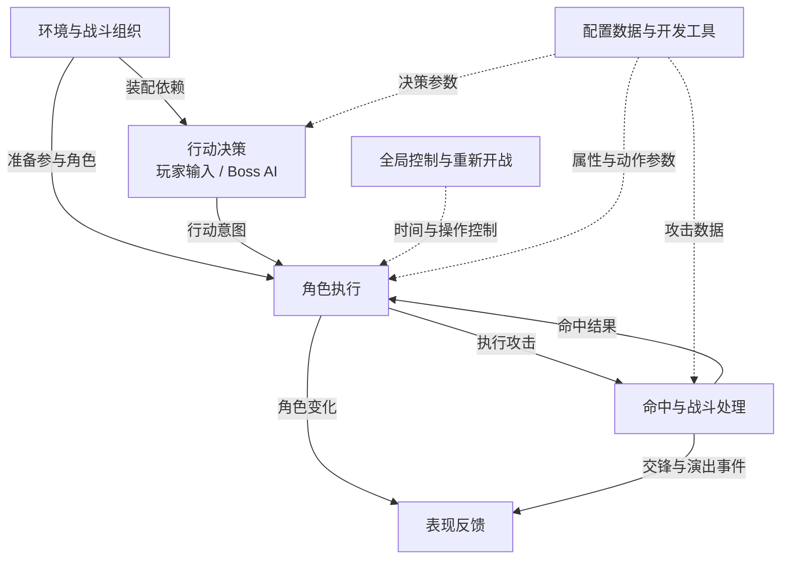
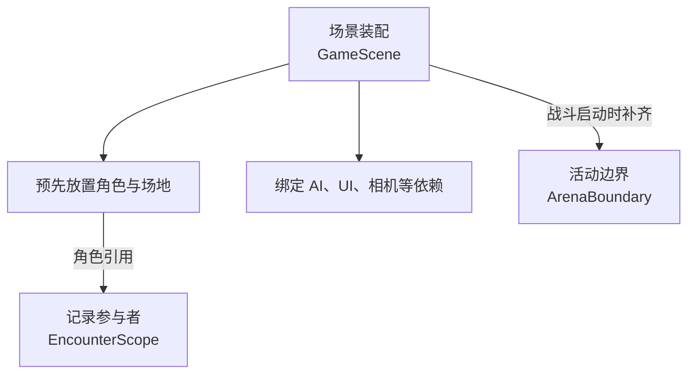
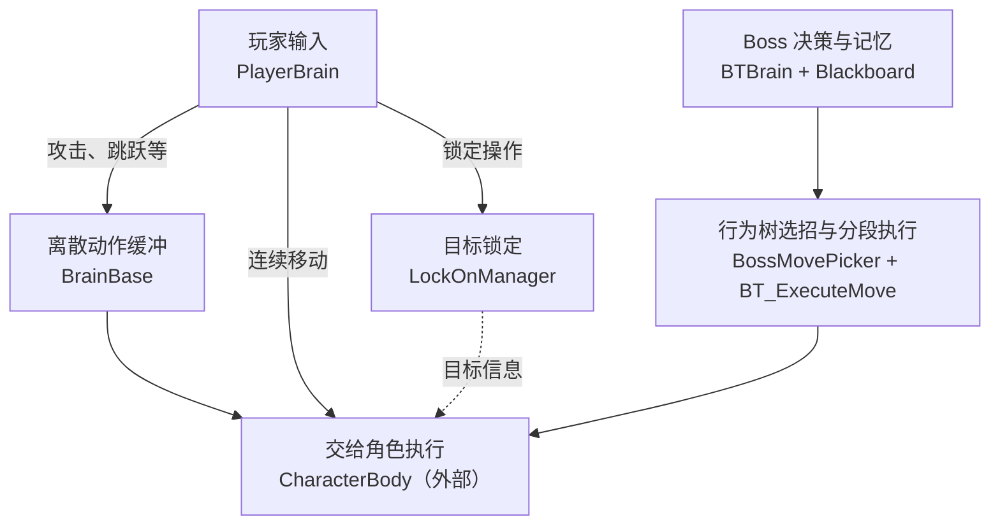
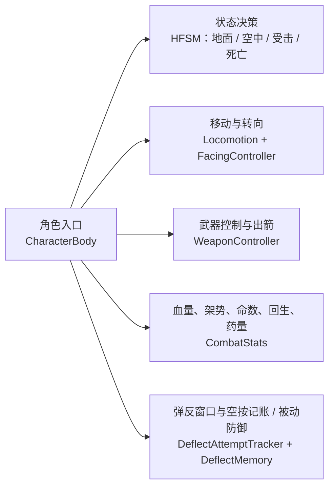
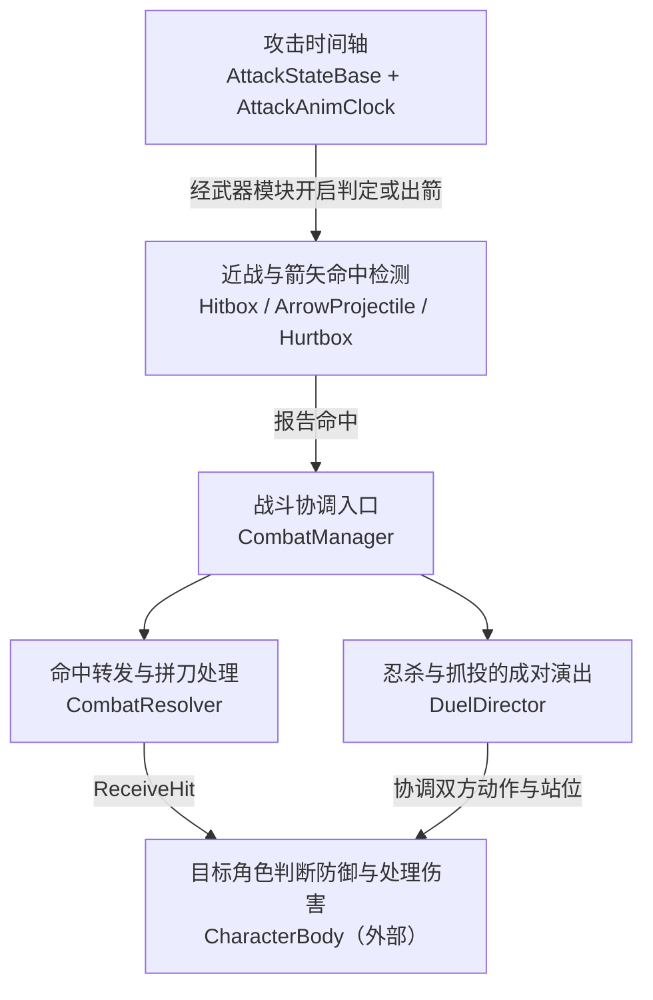
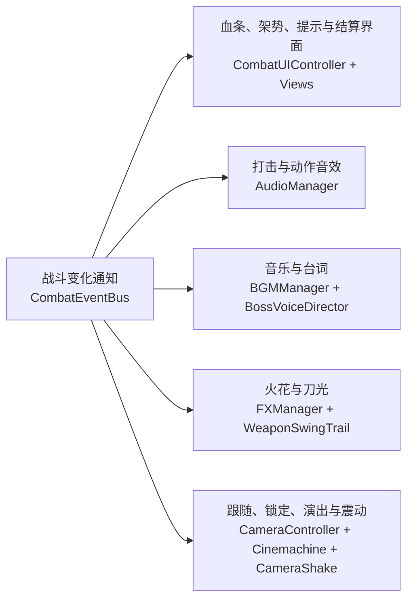
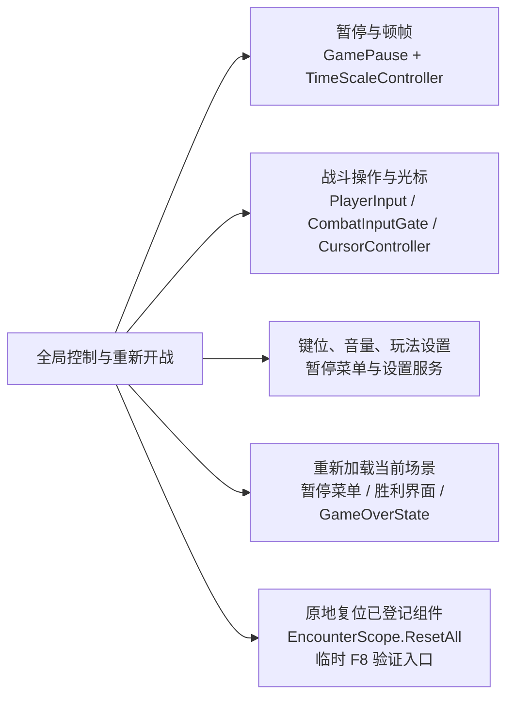
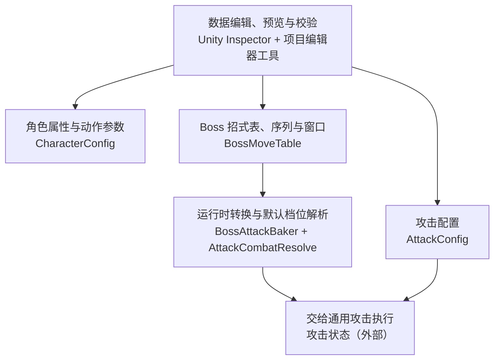

# 项目架构图：复习版

核对日期：2026-10-11（2026-10-15 更新"弹反窗口与空按记账"节点：窗口移入 DeflectAttemptTracker）。

这是当前项目的模块级架构图。同职责脚本合并展示，箭头表示模块之间的主要关系，不表示 Unity 生命周期的严格执行顺序。依据当前源码及 GameScene 的序列化引用整理；本次没有运行 Unity，不作为运行验收或测试通过的证明。

## 大模块关系图

总图只回答“谁向谁提供什么”，不展开类名。实线是主要行为或反馈关系，虚线是装配、配置和全局支持关系。模块是复习时的职责划分，不代表源码已经严格按层隔离。

先读中间主线：行动决策 → 角色执行 → 战斗处理 → 角色响应与表现反馈。环境、全局控制和配置在旁边提供支持。

当前项目用预先装配的 GameScene 准备角色和场地。Boss 选择、动态装配与连战编排属于未来可能增加的外层流程，未画成现有模块。

## 模块一：环境与战斗组织

职责：准备场地和角色，记录本场参与者，把需要的对象引用接起来。

这张小图表示准备工作的分工。ArenaBoundary 由 CombatManager 在运行时确保存在，GameScene 本身不是一个负责调用其他脚本的程序。EncounterScope 不负责生成 Boss 或编排连战；AI、UI、相机也仍有各自的引用绑定路径。

## 模块二：行动决策

职责：确定角色想做什么；玩家从输入得到意图，Boss 从当前战斗条件得到意图。

玩家离散动作使用命令缓冲。Boss 的选招执行器会启动或切换攻击状态，不能把全部 Boss 行为概括为走同一份玩家命令缓冲。锁定系统当前直接使用 CombatManager.BossRef。

## 模块三：角色执行

职责：判断当前能做什么，把行动变成动作，并维护每个角色自己的运行状态。

玩家与 Boss 各有自己的 CharacterBody、状态机和属性。顶层只放四类父状态；待机、攻击、防御、喝药等叶子状态归父状态内部的子状态机管理。HFSM 管逻辑状态，Animator 管动画播放，两者不是同一个状态机。

## 模块四：命中与战斗处理

职责：按动画时间执行攻击，检测是否碰到目标，再协调受击和双方演出。

命中检测不直接扣血。目标角色先判断防御、弹反、无敌等受击响应，再决定是否处理伤害与架势。双方 Hitbox 相交的拼刀分支增加架势并发事件，不走普通扣血链。攻击状态读取动画时间；近战扫描使用 SphereCastAll 与 Overlap 查询，不靠 OnTrigger 主流程。

## 模块五：表现反馈

职责：把战斗变化变成玩家看得到、听得到的反馈。

事件通知把一次战斗变化交给多个订阅方。相机跟随、目标采样以及部分 View 的更新仍有自己的运行逻辑，所以不能把所有表现都称为完全没有轮询。开场台词还会影响 Boss 开始行动，表现与逻辑并非完全隔离。

## 模块六：全局控制与重新开战

职责：协调战斗时间、玩家操作、用户设置和重开方式。下图是职责分解，中心节点不是一个现成的总管理器。

时间控制按暂停优先于顿帧求值。重载场景和原地复位是两条不同路径；已有复位契约不等于实现了完整连战流程。F8 入口需要挂载 EncounterResetDebug。

## 模块七：配置数据与开发工具

职责：提供角色和招式参数，帮助开发者编辑并检查这些数据。

编辑器对 CharacterConfig 使用常规 Inspector；项目定制工具集中在招式、伤害、攻击时间轴、资源处理与校验。BossAttackBaker 将招式的一段转换为运行时 AttackConfig；AttackCombatResolve 包含代码默认档位，因此不是所有战斗数值都只来自 SO。动画、音频、材质与预制体等资源由使用它们的组件持有或加载。

## 复习时的三句话

环境模块把一场战斗准备好；决策模块提出行动，角色模块执行行动。

战斗模块检测和转发命中，目标角色结合当前状态判断如何响应。

表现模块呈现变化；配置与全局控制为整个过程提供数据和运行条件。

## 当前实现的边界

1. 当前没有 Boss 选择与连战流程编排；统一复位能力与完整连战系统是两件事。
2. GameScene 的 EncounterScope 和 CombatManager 都配置了同一组玩家 / Boss 引用。CombatManager.ActivePlayer / ActiveBoss 优先读取 Scope，分别为空时回退到 PlayerRef / BossRef。
3. LockOnManager 当前仍直接读取 CombatManager.BossRef；BTBrain 的 PlayerTarget / PlayerBody、UI 和相机也有各自引用或绑定路径。因此换 Boss 需要核对全部相关依赖，不能只改 Opponents 列表。
4. 暂停菜单和胜利界面的重开按钮走场景重载；GameOverState 也提供重载入口。EncounterResetDebug 的 F8 走原地 ResetAll，属于临时验证入口，使用前须挂载该组件。
5. ResetAll 对已登记组件逐个调用 ResetForEncounter，组件需要自行清理状态。角色、AI、UI、演出及飞行箭矢均有相关复位实现；这不等于已经验证所有切场景或换 Boss 情况。
6. 表现组件订阅 CombatEventBus，也存在目标采样及组件自己的更新逻辑；不能称为全项目标准 MVC，也不能称为表现完全没有轮询。
7. BossVoiceDirector 的开场台词期间会影响 Boss 开始行动；表现与逻辑之间存在这种明确的协作关系，图未展开每个事件及控制条件。

## 编辑器与验证支持

编辑器工具用于配置招式、伤害及时间轴、预览动作和处理资源。ArpgValidationRules 的规则供校验窗口及构建前校验使用，它们不属于玩家战斗中的运行链。

工程还有 Assets/Tests/Editor/CharacterBodyHfsmFlagTests.cs。它是已有的局部测试代码，不能据此称为完整自动化测试体系；本次未运行它。Unity 手动验收入口仍见 ../README.md 中各模块的清单。

## 源码定位

- 场景装配：[GameScene](../../Assets/Scenes/GameScene.unity)。
- 参与者与复位：[EncounterScope](../../Assets/Scripts/Combat/EncounterScope.cs)、[ICombatResettable](../../Assets/Scripts/Combat/ICombatResettable.cs)。
- 玩家意图：[PlayerBrain](../../Assets/Scripts/Player/Brain/PlayerBrain.cs)、[BrainBase](../../Assets/Scripts/Player/Brain/BrainBase.cs)、[LockOnManager](../../Assets/Scripts/Player/Control/LockOnManager.cs)。
- Boss 决策：[BTBrain](../../Assets/Scripts/Boss/BTBrain.cs)、[BossMovePicker](../../Assets/Scripts/Boss/BossMovePicker.cs)、[BT_ExecuteMove](../../Assets/Scripts/Boss/BehaviourTree/BT/BT_ExecuteMove.cs)。
- 角色与状态：[CharacterBody](../../Assets/Scripts/FrameWork/Body/CharacterBody.cs)、[HierarchicalState](../../Assets/Scripts/FrameWork/States/Base/HierarchicalState.cs)。
- 攻击执行：[AttackStateBase](../../Assets/Scripts/FrameWork/States/Base/AttackStateBase.cs)、[WeaponController](../../Assets/Scripts/FrameWork/Body/WeaponController.cs)、[BossAttackBaker](../../Assets/Scripts/Boss/BossAttackBaker.cs)。
- 命中与结算：[Hitbox](../../Assets/Scripts/Combat/Hitbox.cs)、[ArrowProjectile](../../Assets/Scripts/Combat/ArrowProjectile.cs)、[CombatManager](../../Assets/Scripts/Combat/CombatManager.cs)、[CombatResolver](../../Assets/Scripts/Combat/CombatResolver.cs)、[DuelDirector](../../Assets/Scripts/Combat/DuelDirector.cs)。
- 表现通知：[CombatEventBus](../../Assets/Scripts/Mgr/CombatEventBus.cs)、[CombatUIController](../../Assets/Scripts/UI/CombatUIController.cs)、[CameraController](../../Assets/Scripts/Camera/CameraController.cs)。
- 暂停与时间：[PauseMenuController](../../Assets/Scripts/UI/PauseMenuController.cs)、[GamePause](../../Assets/Scripts/Mgr/GamePause.cs)、[TimeScaleController](../../Assets/Scripts/Mgr/TimeScaleController.cs)。

复习时先理解每个模块解决的问题，再沿某一条行为链查实现。先讲清角色做了什么，再讨论为什么这样分工。
