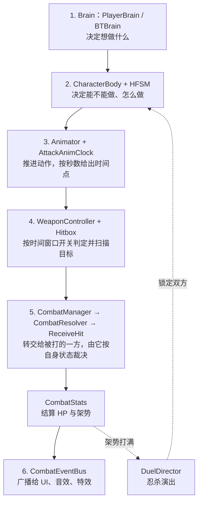

## 1. 战斗里有哪些模块，怎样接起来

一次攻防从“有人想出招”到“血条和音效变化”，要经过六个环节。每个环节只做一件事，把结果交给下一个环节：



| 环节 | 主要类 | 职责 |
| :--- | :--- | :--- |
| 1. 意图 | `PlayerBrain`、`BTBrain`（都在 `CharacterBody` 所在对象上） | 玩家端采集输入、维护 0.2s 的预输入缓冲；Boss 端用行为树结合距离、冷却、权重选招。两者都只表达“想做什么”，不执行动作 |
| 2. 动作控制 | `CharacterBody`、HFSM | 接收指令，由当前状态决定能不能做、切到哪个状态 |
| 3. 动作推进 | `Animator`、`AttackAnimClock` | Animator 播放动画和根运动；攻击状态用 `AttackAnimClock` 把动画进度换算成秒，开关判定、音效都按这个秒数走，不依赖 Animation Event |
| 4. 判定检测 | `WeaponController`、`Hitbox` | `WeaponController` 管理刀、肘、脚的 Hitbox，`Hitbox` 在 `LateUpdate` 里用 `SphereCastAll` 和 `OverlapSphere` 等扫描目标，同一次挥砍对同一目标只上报一次 |
| 5. 裁决与数值 | `CombatManager`、`CombatResolver`、`CharacterBody.ReceiveHit`、`CombatStats` | 命中先上报给 `CombatManager`，转给 `CombatResolver`，再调用被打一方的 `ReceiveHit`。接触不等于扣血：被打一方的当前状态决定是穿过、弹反、格挡还是受击。`CombatStats` 保存运行时的 HP 与架势 |
| 6. 表现与收尾 | `CombatEventBus`、`DuelDirector` | `CombatEventBus` 是静态事件总线，UI、音效、特效订阅它，战斗逻辑不直接引用它们；`DuelDirector` 负责忍杀的双人演出和演出期间的输入锁 |

---

## 2. CharacterBody：角色的统一入口

`CharacterBody` 挂在玩家和 Boss 的根对象上，两者共用同一个类。Brain、状态、其他战斗系统都通过它访问角色的能力，不直接碰内部模块：

```text
CharacterBody
  ├─ MainStateMachine        顶层状态机（HFSM 的入口）
  ├─ Animator / Rigidbody    动画与刚体（Unity 组件）
  ├─ Loco（Locomotion）      移动、接地检测、跳跃
  ├─ Facing（FacingController） 朝向、转向、根旋转
  ├─ WeaponCtrl（WeaponController） Hitbox 槽位、出箭
  ├─ Combat（CombatStats）   HP、架势、葫芦、命数
  └─ Config（CharacterConfig） 只读配置（ScriptableObject）
```

`Loco`、`WeaponCtrl`、`Combat`、`Facing` 在 `CharacterBody` 里是私有成员，只通过 `CharacterBody` 的公开方法使用，比如：

```csharp
// CharacterBody.cs（节选）
public void EnableWeaponHit(AttackConfig config) => WeaponCtrl.EnableWeaponHit(config);
public void DisableWeaponHit() => WeaponCtrl.DisableWeaponHit();
public void SnapYaw(Vector3 worldDir, string holdUntilState = null) => Facing.SnapYaw(worldDir, holdUntilState);
public void SetSuppressRootYaw(bool suppress) => Facing.SetSuppressRootYaw(suppress);
```

状态里需要开判定、转向时，只调用 `body.EnableWeaponHit(...)`、`body.SnapYaw(...)` 这类方法，不关心 `WeaponController`、`FacingController` 怎么实现。

### 配置与运行时数据分开
`CharacterConfig` 是 ScriptableObject，存放最大血量、最大架势、架势回复速度、硬直时长等配置。源码注释写明：最大值和规则在配置里，当前数值在角色实例里。

当前 HP 和架势保存在每个角色自己的 `CombatStats` 里，构造时从 `Config` 复制初始值：

```csharp
// CombatStats.cs（节选）
public void ResetForEncounter()
{
    // 将配置值复制到运行时属性；战斗中改变 CurrentHP 等值不会修改配置资产。
    CharacterConfig config = body.Config;
    CurrentHP = config.MaxHP;
    CurrentPosture = 0f;
    ...
}
```

多个角色可以引用同一份配置，各自的血量和架势互不影响，战斗中也不会改动配置资产。

---

## 3. 状态机在角色里的位置

`CharacterBody.Update()` 驱动 `MainStateMachine`，状态机再逐层驱动当前状态。顶层状态管角色处于什么大环境，地面状态内部还有子状态机管具体动作：

```text
MainStateMachine
  ├─ GroundedState（父状态）   地面公共规则：离地检测、跳跃、喝药
  │    └─ SubStateMachine      待机 / 移动 / 攻击 / 格挡弹反 / 垫步 / 喝药 /
  │                           忍杀演出（FinisherState 等）等
  ├─ AirState（父状态）        空中
  ├─ StunnedState（父状态）    受击硬直
  └─ DeadState（父状态）       死亡
```

要点：
- 每台 `StateMachine` 只持有本层的一个当前状态；
- 指令先问父状态，父状态不处理再交给当前子状态。父状态返回 `false` 的意思是“父层不干涉”，不是拒绝；
- 离开父状态时，子状态机会被清空，当前子状态的 `OnExit` 会被调用，保证攻击判定等被关掉。

指令路由、状态切换和级联退出的具体过程见章节 3。

---

## 4. 一次攻防从头到尾

同一时刻要同时看攻击方和防守方。以攻击方打出一刀、防守方受击为例：

```text
【A. 出招】
1. 攻击方的 Brain 产生攻击指令（玩家按键，或 Boss 行为树选招）；
2. 指令经过 CharacterBody 和 HFSM，被当前状态接受，切到 AttackState；
3. AttackState 每帧用 AttackAnimClock 读出动画秒数，到判定窗口时调用
   body.EnableWeaponHit，开启 Hitbox；
4. Hitbox 在 LateUpdate 里扫描，扫到防守方的 Hurtbox。

【B. 上报与裁决】
5. Hitbox 调用 CombatManager.ReportHit，转给 CombatResolver.ReportHit；
6. CombatResolver 调用防守方的 CharacterBody.ReceiveHit，
   把伤害、架势伤害、命中点等打包成 HitData；
7. ReceiveHit 先让防守方的当前状态（沿父状态 → 子状态）通过 OnHitReceived 处理：
   ├─ DodgeState：无敌帧内返回 true，这次命中被忽略；
   ├─ DeflectState：弹反窗口内完美弹反，窗口外普通格挡，都由防御状态自行处理；
   └─ 其他状态没有拦截：由 CharacterBody 扣血、涨架势，并切入受击状态 StunnedState。

【C. 数值与表现】
8. CombatStats 结算 HP 与架势；架势打满时通过回调让 CharacterBody 进入崩解状态；
9. CombatEventBus 广播事件，UI 刷新血条和架势条，AudioManager 播放音效；
10. Boss 崩解后，玩家可触发忍杀，由 DuelDirector 锁定双方并播放同步演出。
```

后面的章节依次展开这条链上的各个环节：章节 2 讲第 1 步的输入与缓冲，章节 3 讲第 2 步的状态路由，章节 4 讲第 3 步的动作推进，章节 5 讲第 4 到 8 步。
