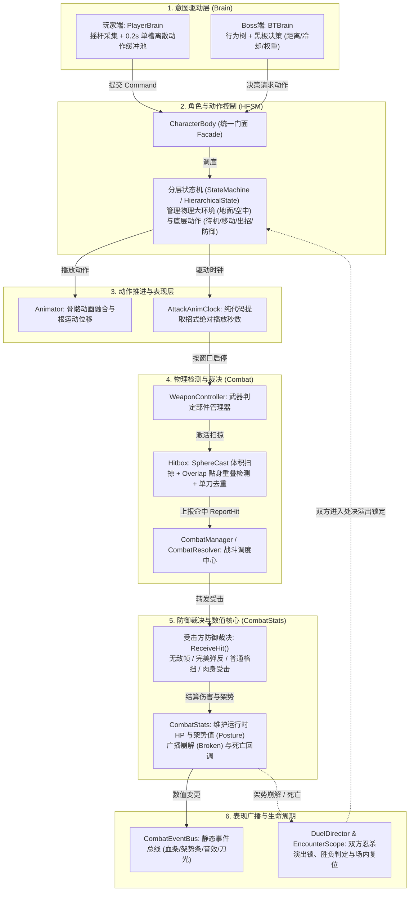

## 1. 战斗全流程闭环：六大核心子系统协同网络

《只狼》Boss 战的核心架构由六大子系统构成。整个战斗系统的运转不是单向的线性脚本，而是一个高度解耦、状态互动的闭环网络：



### 六大系统核心职责与交接边界
1. **意图驱动层（Brain）**：
   - 负责“想做什么”，自身不包含任何动作执行逻辑；
   - 玩家端（`PlayerBrain`）处理玩家输入与预输入缓冲；Boss 端（`BTBrain`）由行为树结合黑板条件（距离、招式冷却、随机权重）做出决策；
   - 两者最终统一抽象为动作请求或指令，交由角色执行。
2. **角色与动作控制（HFSM）**：
   - 负责“能不能做、怎么做”；
   - `CharacterBody` 门面持有分层状态机，通过父子分层结构解耦不同大环境（地面、空中、受击、处决）下的动作规则。
3. **动作推进与表现层（Animator & Clock）**：
   - C# 状态机负责逻辑判定，Unity Animator 负责美术动作表现与根运动；
   - 摆脱对不可靠的 Unity Animation Event 的依赖，通过 `AttackAnimClock` 纯代码轮询绝对动画时间。
4. **物理检测与去重（Combat）**：
   - `WeaponController` 管理刀刃、肘击、踢腿等各部位的 `Hitbox`；
   - `Hitbox` 在 `LateUpdate` 阶段利用 `SphereCastAll` 扫掠与 `OverlapSphere` 重叠检测，彻底解决高速挥刀穿模与贴身漏判，并在当前攻击段内对受击目标强去重。
5. **防御裁决与数值核心（CombatStats）**：
   - **接触不等于必然扣血**：检测到命中后由 `CombatResolver` 转发至受击者 `CharacterBody.ReceiveHit`，受击者根据自身当前状态进行裁决（完美弹反、普通格挡、闪避无敌帧、受击硬直）；
   - `CombatStats` 独立维护运行时当前的血量与架势条，并在架势打满时触发崩解回调。
6. **表现广播与生命周期（EventBus & Lifecycle）**：
   - `CombatEventBus` 将战斗底层与表现层（UI、音频、特效）完全解耦；
   - `DuelDirector` 负责管理双方忍杀处决时的双人同步对齐、演出锁机制以及战斗重开与胜负结算。

## 2. CharacterBody 内部组织：门面模式（Facade）的能力收敛

`CharacterBody` 挂载在角色根节点上，是整个角色对外交互的唯一门面（Facade）。动作状态、外界系统均通过 `CharacterBody` 进行协作，严禁越权直接访问私有底层组件：

```text
CharacterBody (角色统一门面)
  │
  ├─ [行为控制核心]
  │    ├─ MainStateMachine    ─── 顶层分层状态机 (驱动 Grounded / Air / Stun / Finisher 等大状态)
  │    ├─ Animator            ─── 骨骼动画控制器 (动作融合 CrossFade、Root Motion 根运动)
  │    └─ Rigidbody           ─── 物理刚体 (配合 Kinematic 锁定与真实物理受击推力)
  │
  ├─ [专职子控制器]
  │    ├─ Locomotion          ─── 运动控制器 (地面环境感知、斜坡贴合、重力与移动平滑)
  │    ├─ FacingController    ─── 朝向控制器 (锁定目标注视、挥刀转向锁定与转身平滑)
  │    ├─ WeaponController    ─── 武器部件管理器 (多判定体槽位启停、拖尾特效绑定)
  │    └─ CombatStats         ─── 战斗数值核心 (HP、架势值、减伤率、崩解与死亡回调)
  │
  └─ [静态配置解耦]
       └─ CharacterConfig     ─── ScriptableObject 资产 (基础血量、架势恢复曲线、基础速度)
```

### 协作与解耦原则
- **配置与运行时分离**：`CharacterConfig` 是只读的 ScriptableObject 资产文件，负责提供策划配置数据；角色运行时的血量、架势由各对象身上的 `CombatStats` 独占实例维护，多角色共享配置绝不会发生数值串扰。
- **状态不越权原则**：具体动作状态（如 `AttackState`、`DeflectState`）仅持有所属 `body` 引用。状态需要开判定时调用 `body.EnableWeaponHit()`，需要转向时调用 `body.SnapTowardTarget()`，无需关心底层组件如何实现。

## 3. 分层状态机（HFSM）的分层解耦与安全机制

在复杂的 ARPG 中，单层有限状态机（FSM）会导致状态跳转连线呈指数级爆炸（待机、移动、轻击、重击、蓄力时，任何时候都可能需要响应“起跳”、“喝药”、“被击飞”或“落入悬崖”）。HFSM 通过分层收敛了公共规则：

### 核心分层架构

```text
MainStateMachine (顶层主状态机)
  │
  ├─ GroundedState (地面父状态) ─── 收敛所有地面环境公共规则 (离地检测、跳跃指令、使用道具)
  │    └─ SubStateMachine (地面子状态机)
  │         ├─ IdleState        ─── 地面待机 (接收移动、攻击、闪避指令)
  │         ├─ MoveState        ─── 地面移动
  │         ├─ AttackState      ─── 地面挥刀 (维护攻击判定与取消窗口)
  │         ├─ DeflectState     ─── 地面格挡 / 弹反 (维护防御姿态与受击硬直)
  │         └─ DodgeState       ─── 地面垫步闪避 (提供无敌帧与快速位移)
  │
  ├─ AirState (空中父状态)      ─── 收敛下落重力、空中下劈与落地判定
  ├─ StunState (受击硬直)       ─── 普通受击硬直与架势崩解瘫痪
  └─ FinisherState (忍杀演出)   ─── 双方霸体、位移吸附与处决镜头同步
```

### HFSM 的三大运行机制
1. **单一层级单一当前态**：
   每个 `StateMachine` 实例仅管理本层级的 `CurrentState`。主状态机的当前态是 `GroundedState`，地面子状态机的当前态是 `IdleState`。
2. **父层优先拦截与向下放行规则**：
   - 处于地面状态时，任何输入先经过 `GroundedState.OnParentHandleCommand()`；
   - 若是跳跃命令（`JumpCommand`），父层直接截胡并切到 `AirState`，指令在父层终止，**绝不下传**；
   - 若是攻击、闪避等指令，父层不处理并返回 `false`，**放行下传**给底层活跃的子状态（如 `IdleState`）进行动作切换。
   > **核心理解**：父状态返回 `false` 绝非拒绝命令，而是代表“父层规则不干涉，交由子状态自主裁决”。
3. **父状态退出时的级联清理（Cascade Exit）**：
   若角色在挥刀或防御过程中意外被击飞或掉落平台，主状态机强制切至 `AirState`。此时旧的父状态 `GroundedState.OnExit()` 会级联触发 `SubStateMachine.ChangeState(null)`，强制切断当前子状态，迫使当前的 `AttackState` 或 `DeflectState` 执行 `OnExit()`，彻底关掉武器 Hitbox、注销无敌帧，**杜绝任何动作残留 Bug**。

## 4. 攻防对抗的系统级跨模块交互全景

为了彻底理解整个战斗系统的运作，必须将**“攻击方”与“防守方”两个独立的实体放在同一时空下考察**：

```text
【阶段 A：意图与出招】
1. 攻击方决策：PlayerBrain 收集玩家按键 (或 Boss 行为树决策) 提交攻击意图；
2. 动作路由：攻击方 HFSM 判定放行，切换至 AttackState；
3. 时钟与扫掠：AttackAnimClock 读取动画秒数，到达判定窗口时通知 WeaponController 激活 Hitbox；
4. 几何查询：Hitbox 在 LateUpdate 执行 SphereCast 扫掠，检测到防守方的 Hurtbox 碰撞体。

【阶段 B：中枢调度与防御裁决】
5. 上报调度：Hitbox 形成 HitContext，上报给全局 CombatResolver；
6. 目标拦截：CombatResolver 调用防守方 CharacterBody.ReceiveHit(context)；
7. 状态裁决：防守方依据自身当前状态进行即时裁决：
   ├─ 若防守方处于 DodgeState (无敌帧期间) ─── 判定完全穿透，不造成任何影响；
   ├─ 若防守方处于 DeflectState (完美弹反窗) ─── 触发弹反！攻击方被弹刀硬直，防守方仅涨极少架势；
   ├─ 若防守方处于 DeflectState (普通格挡期) ─── 免除物理伤害，防守方扣减大量架势值；
   └─ 若防守方处于 Idle / Attack 等无防御态 ─── 肉身受击！扣除 HP，强制打断防守方当前动作切入受击态。

【阶段 C：数值沉淀与反馈广播】
8. 数值结算：受击方 CombatStats 结算 HP 与 Posture，若架势打满，触发 OnPostureBroken 回调；
9. 表现广播：CombatEventBus 同步广播事件，UI 刷新血条/架势条，AudioManager 播放弹刀铁音；
10. 决胜演出：当 Boss 架势崩解且触发处决时，DuelDirector 锁定双方动作，进入终结忍杀演出。
```
