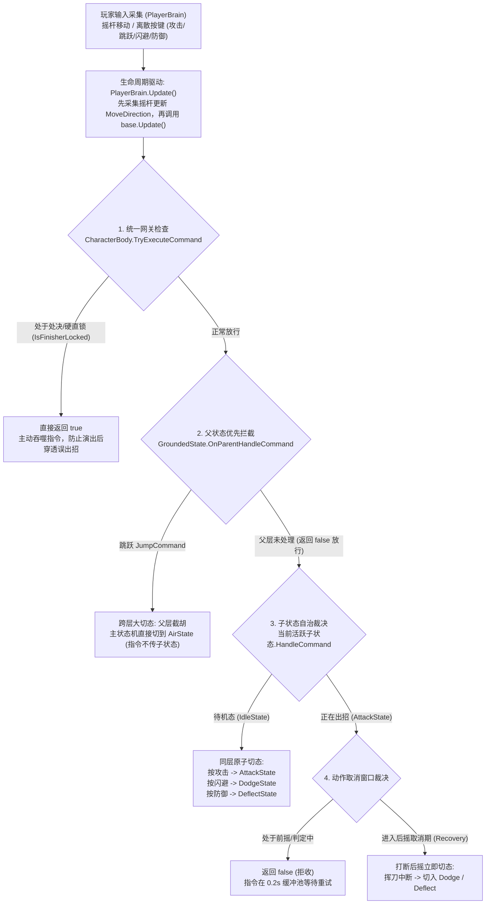

## 1. 核心流程全景：输入命令流转与多级动作裁决

在 Command + HFSM 架构中，角色的动作切换绝不是简单的“按键直接触发切态”，而是一套经过**“意图缓冲 $\rightarrow$ 统一网关 $\rightarrow$ 分层路由 $\rightarrow$ 窗口裁决”**的多级调度体系：



```text
【典型指令分流调用链速览】
PlayerBrain.Update()
  ├─ 1. 更新连续输入: body.MoveDirection = currentMoveInput
  ├─ 2. 显式调用 base.Update() -> BrainBase.ProcessCommandBuffer()
  │       └─ CharacterBody.TryExecuteCommand(bufferedCmd)
  │            ├─ [分支 A: 处决锁拦截] IsFinisherLocked == true -> 直接 return true 吞噬
  │            └─ MainStateMachine.HandleCommand(bufferedCmd)
  │                 └─ GroundedState.HandleCommand(bufferedCmd)
  │                      ├─ [分支 B: 父层截胡] OnParentHandleCommand(JumpCommand) -> 切至 AirState (返回 true)
  │                      └─ [分支 C: 子层自治] SubStateMachine.CurrentState.HandleCommand(cmd)
  │                           ├─ IdleState: 收到 Attack / Dodge / Deflect -> 立即 ChangeState 切入动作
  │                           └─ AttackState: 检查取消窗口 -> 未到后摇返回 false; 到后摇立即打断切态
  └─ 3. 提交连续移动: body.TryExecuteCommand(MoveCommand)
```

## 2. 意图抽象与驱动生命周期（Command + PlayerBrain.Update）

### 1. 为什么采用 Command 模式解耦？
- **意图与数据解耦**：`ICommand` 仅代表“发出了什么意图”（如 `AttackCommand`、`JumpCommand`），自身不持有任何动画资源、伤害数值或物理逻辑；
- **输入源解耦**：角色状态机仅面向 `ICommand` 协议，完全不感知指令是来自玩家键盘、手柄输入，还是来自 Boss 行为树决策；
- **支持时序缓冲**：对象化的命令使得在状态机处于后摇或暂时无法响应时，可以安全地存入单槽缓冲池进行生命周期管理。

### 2. 驱动源头的真实时序：`PlayerBrain.Update()`
挂载在角色 GameObject 上的 MonoBehaviour 组件是子类 `PlayerBrain`。Unity 引擎每帧调用其重写的 `Update()`，驱动顺序严谨有序：

```csharp
// PlayerBrain.cs
protected override void Update()
{
    if (GamePause.IsPaused) return;
    if (CombatInputGate.Blocked) { ClearActionInput(); return; }

    // 1. 蓄力突刺长按检测：按住超过阈值则配置 ActiveAttack = ThrustAttack 并缓冲 AttackCommand
    ProcessHeldAttack();

    // 2. 采集连续摇杆移动：死区过滤后直接写入 body.MoveDirection
    Vector2 rawInput = moveAction.ReadValue<Vector2>();
    Vector2 currentMoveInput = rawInput.sqrMagnitude < 0.01f ? Vector2.zero : rawInput;
    body.MoveDirection = currentMoveInput;

    // 3. 【核心交接】显式调用 base.Update()，由 BrainBase 轮询单槽缓冲池 ProcessCommandBuffer()
    base.Update();

    // 4. 破防防守补偿检查
    if (body.IsPostureBroken && deflectAction.IsPressed() && !HasBufferedCommand<DeflectCommand>())
        BufferCommand(DeflectCommand.System(), 0.15f);

    // 5. 连续移动指令逐帧直通，不占离散缓冲池
    body.TryExecuteCommand(new MoveCommand(currentMoveInput));
}
```

> **关键时序理解**：为什么垫步（闪避）一进入状态就能立即朝摇杆方向位移？  
> 正是因为在第 2 步先给 `body.MoveDirection` 赋了值，紧接着第 3 步 `base.Update()` 消费缓冲中的 `DodgeCommand` 时，闪避状态的 `OnEnter()` 就能当帧拿到最新的输入方向。

### 3. 输入双轨设计对比：离散指令 vs 连续控制

| 输入维度 | 离散动作指令（`Attack / Deflect / Dodge / Jump`） | 连续控制指令（`Move`） |
| :--- | :--- | :--- |
| **存储策略** | **单槽缓冲池（`bufferedCommand`）**，新指令覆盖旧指令 | **无缓冲池，逐帧刷新** |
| **生命周期** | 拥有 `0.2s` TTL 倒计时；状态机拒收时逐帧重试直至超时丢弃 | 仅在当前帧有效，下一帧由摇杆最新读数覆盖 |
| **消费逻辑** | 状态机返回 `true` 即被清空；返回 `false` 继续保留重试 | 无论当前状态能否移动，每帧由 `body.MoveDirection` 直通传递 |

## 3. HFSM 通用命令路由与多级动作裁决

输入命令通过 `CharacterBody.TryExecuteCommand` 进入状态机后，HFSM 通过四级严谨的过滤网决定动作的切换与打断：

### 第一级：角色统一网关与演出锁拦截
```csharp
// CharacterBody.cs
public bool TryExecuteCommand(ICommand cmd)
{
    if (IsFinisherLocked)
        return true; // 处决演出锁中直接吞噬输入
    return MainStateMachine.HandleCommand(cmd);
}
```
- **返回值 `true` 的真正业务语义**：  
  在状态机架构中，返回 `true` 代表**“该命令已被消费，调用方无需再保留或重试”**。它包含两种情况：
  1. **有效执行**：下游状态机完成了动作切换；
  2. **主动拦截**：处于忍杀处决等阶段（`IsFinisherLocked`），系统主动吞噬输入，防止狂按导致的预输入穿透到演出后误出招。

### 第二级：父状态拦截（跨物理环境的层级大切态）
```csharp
// HierarchicalState.cs
public override bool HandleCommand(ICommand cmd)
{
    // 1. 父状态优先检查公共规则
    if (OnParentHandleCommand(cmd)) return true;

    // 2. 父层未处理，才转交当前活跃的子状态
    if (SubStateMachine.CurrentState != null)
        return SubStateMachine.CurrentState.HandleCommand(cmd);

    return false;
}
```
- **典型案例：跳跃命令（`JumpCommand`）**  
  当角色在地面待机、跑步甚至轻微位移时按下跳跃，`GroundedState.OnParentHandleCommand` 捕获到 `JumpCommand`：
  - 父层直接调用 `MainStateMachine.ChangeState(new AirState(body))`；
  - 返回 `true` 终结下传。
  - **核心价值**：跳跃是改变“物理大环境（地面 $\rightarrow$ 空中）”的宏观规则，由父状态统一管理，**根本无需在每个待机、移动、喝药等子状态中重复编写跳跃代码**。
- **返回 `false` 的放行语义**：当父层返回 `false` 时，**绝不代表命令被拒**，而是表明“父层规则不干涉，放行交由子状态自行裁决”。

### 第三级：子状态自治（同层基础动作的原子切换）
当命令穿透父状态到达当前叶子状态（如 `IdleState`）时，由子状态根据自身特性决定切换：
- **收到 `AttackCommand`**：提取配置，调用 `SubStateMachine.ChangeState(new AttackState(...))`；
- **收到 `DodgeCommand`**：调用 `SubStateMachine.ChangeState(new DodgeState(...))` 切入垫步；
- **收到 `DeflectCommand`**：携带唯一的 `pressId` 切入 `DeflectState`（使用 `pressId` 保证 0.2s 缓冲内多次重试不会重复刷新弹反窗口）。

### 第四级：动作执行中的打断裁决（取消窗口 Cancel Window）
如果角色正在做动作（例如正处于 `AttackState` 挥刀中），此时玩家按下了闪避（`DodgeCommand`）或防御（`DeflectCommand`）：
- **前摇硬直与判定期间（`animTime < RecoveryWindowStart`）**：
  `AttackState` 检查取消窗口尚未开放，`HandleCommand` 返回 `false`。
  - 命令留在 `BrainBase` 缓冲池中，倒计时递减；
- **进入后摇取消期（`animTime >= RecoveryWindowStart`）**：
  `AttackState` 检查判定为可打断，响应 `DodgeCommand`，直接调用 `SubStateMachine.ChangeState(new DodgeState(...))`。
  - **结果**：成功打断攻击后摇，实现丝滑取消（Action Canceling），同时清空缓冲池。

## 4. 状态机的通用原子切换（ChangeState）与级联清理

无论是切换攻击、闪避还是受击，底层的 `StateMachine.ChangeState(...)` 都严格执行四步原子流转：

```text
1. [旧态退出]  旧 CurrentState.OnExit()  ─── 还原状态标记、关闭碰撞体、注销事件
2. [指针重置]  PreviousState = CurrentState
              CurrentState = newState    ─── 指针正式原子重定向
3. [新态进入]  新 CurrentState.OnEnter() ─── 状态初始化、请求动画 CrossFade、开启时钟
4. [调试记录]  更新状态切换计数与状态快照
```

### 切换前后的状态机层级对照

| 动作切换场景 | 顶层主状态机（`MainStateMachine`） | 子状态机（`SubStateMachine`） | 切换机制分析 |
| :--- | :--- | :--- | :--- |
| **待机 $\rightarrow$ 挥刀** | `GroundedState`（保持不变） | `IdleState` $\rightarrow$ **`AttackState`** | **同层子状态切换**。物理大环境未变。 |
| **待机 $\rightarrow$ 垫步** | `GroundedState`（保持不变） | `IdleState` $\rightarrow$ **`DodgeState`** | **同层子状态切换**。进入位移与无敌帧。 |
| **地面 $\rightarrow$ 起跳** | `GroundedState` $\rightarrow$ **`AirState`** | 子状态机被整体销毁清空 | **跨层大切态**。父层截胡并驱逐子状态。 |

### 级联退出（Cascade Exit）的安全底线
当角色在挥刀或防御过程中意外被 Boss 击飞或掉落悬崖时，主状态机会切换至 `AirState`。此时旧的父状态 `GroundedState` 退出，其基类 `HierarchicalState.OnExit()` 强制调用 `SubStateMachine.ChangeState(null)`。
- 这迫使正在执行的 `AttackState` 完整走完 `OnExit()`；
- 彻底关闭武器 Hitbox、注销转向锁定并清除霸体标记；
- **保证无论动作以何种异常途径被打断，绝不会发生“Hitbox 留在场上无限扣血”的恶性 Bug**。
