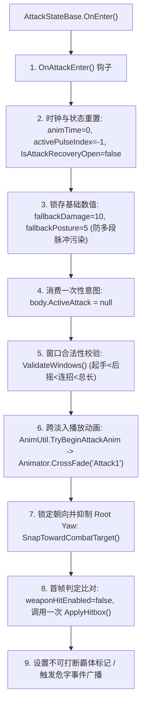
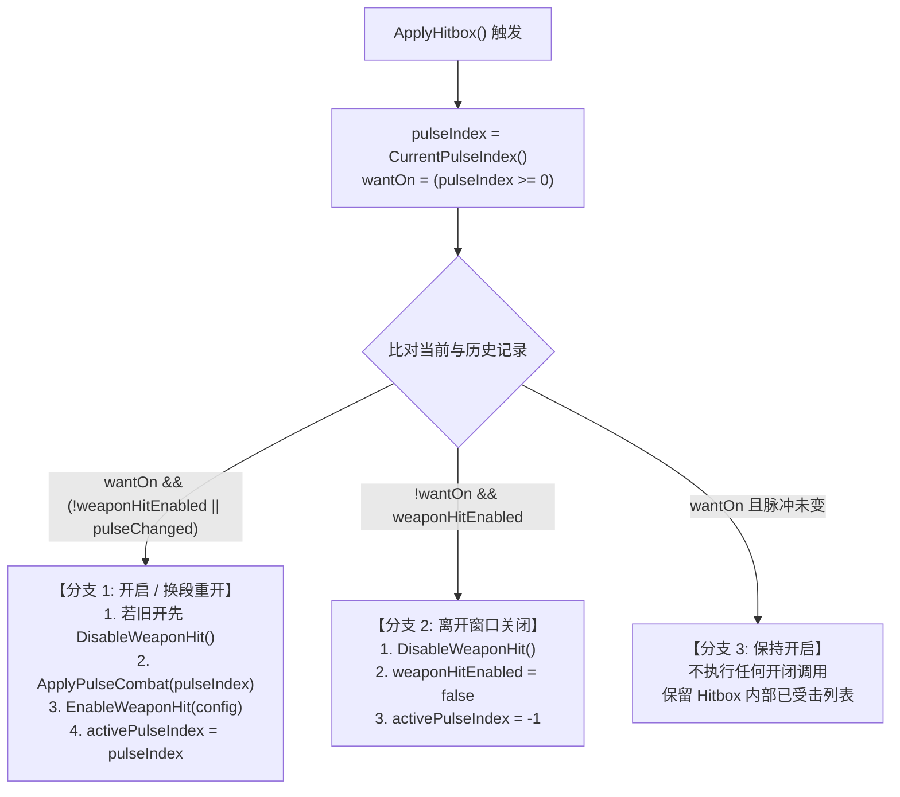

## 1. 核心参与模块与职责分工

本模块的职责是将一份静态的招式配置（Asset），执行为一次具备完整生命周期、有效判定窗口及安全收尾清理的动作：

- **`AttackConfig`**：提供动画名、基础伤害、命中脉冲窗口（`hitPulses`）、后摇开放时刻与连招关系。
- **`AttackStateBase`**：抽象基类，负责攻击生命周期、驱动动画时钟、计算判定脉冲启停、派发音效/投射物、统一清理退出。
- **`AttackState`**：地面攻击具体状态，继承基类，补充退回待机（`ExitToIdle`）与地面取消窗口。
- **`AttackAnimClock`**：负责从 Unity Animator 状态中提取当前招式播放的真实秒数（`animTime`）。
- **`WeaponController`**：按配置选择并启停对应的 `Hitbox` 槽位（刀刃、肘部或脚部判定体）。
- **`Hitbox`**：执行实际的几何命中查询（SphereCast 扫掠、Overlap 重叠），维护单次命中去重列表。

## 2. 真实招式资产数据（以 Player 轻攻击一段 atk1 为例）

```yaml
AnimName: Attack1              # 绑定的 Animator 状态名称
BaseDamage: 10                # 招式基础物理伤害
PostureDamage: 5             # 招式基础架势伤害
HitStartTime: 0.23            # 前摇结束 / 最早取消时间点
StateDuration: 1.467          # 状态总配置持续时长
RecoveryWindowStart: 0.50     # 后摇开放时刻 (可接翻滚/防御)
ComboWindowEnd: 0.66          # 连招可输入截止时刻
WaitAnimEnd: false            # 是否必须强制等待动画播完
```

### 关联近战脉冲（`hitPulses`）
```yaml
hitPulses:
  - start: 0.23               # 判定开启时刻
    end: 0.50                 # 判定关闭时刻
    overrideCombat: 0         # 是否覆盖伤害 (0 = 沿用 BaseDamage: 10, Posture: 5)
```

- **有效判定区间**：`[0.23s, 0.50s)`（左闭右开），只有在此区间内物理检测才真正开启。
- **节奏与判定的分工**：`HitStartTime` 与 `RecoveryWindowStart` 仅控制动作取消节奏，判定启停完全由 `hitPulses` 驱动。
- **连招机制**：`NextCombo` 存在不代表会自动接招，还需要玩家在有效窗口内再次按下攻击键。

## 3. 第一阶段：进入攻击态（OnEnter 的 9 步初始化）



> **首帧判定行为**：进入当帧 `animTime = 0`，未落入 `[0.23, 0.50)` 脉冲区间。因此首帧执行的 `ApplyHitbox()` 计算出 `wantOn = false`，**Hitbox 维持关闭状态**，确保起手前摇绝无攻击判定。

## 4. 第二阶段：逐帧推进与时钟驱动（Update & AttackAnimClock）

每帧由主状态机逐级传递至 `AttackStateBase.OnUpdate()`，内部流水线严格按顺序执行：

```text
AttackStateBase.OnUpdate()
  │
  ├─ 1. animTime = AttackAnimClock.ReadSeconds(...) ─── 读取本招当前绝对播放秒数
  ├─ 2. 更新 IsAttackRecoveryOpen = (animTime >= 0.50) ─ 标记是否已进入后摇取消期
  ├─ 3. ApplyHitbox() ───────────────────────────────── 按当前窗口执行 开启 / 保持 / 关闭
  ├─ 4. ApplySfx() / ApplyArrows() ──────────────────── 触发音效与投射物 Cue
  ├─ 5. UpdateAttackSteer() ─────────────────────────── 若允许转向，平滑修正模型朝向
  └─ 6. 检查结束退出条件 ────────────────────────────── 满足退出条件时调用 ExitToIdle()
```

### 动画时钟原理：为什么不用 Animation Event，改用 `AttackAnimClock`？
- **Unity 动画事件的缺陷**：帧率波动容易丢帧漏事件；动作被外部打断切走时，后置的关闭事件无法触发导致判定残留；动画 Clip 重新导入时容易丢失事件标记。
- **纯代码时钟解决方案**：
  - 过渡融合期间，优先读取匹配本招短名的下一状态；
  - 若已进入本招，读取当前状态并通过公式换算绝对秒数：
    $$\text{animTime} = \text{info.normalizedTime} \times \text{info.length}$$
  - 纯代码轮询比对窗口，确定性极高，不受帧率波动影响。

## 5. 第三阶段：近战判定核心控制 —— `ApplyHitbox` 状态机决策算法

### 1. 四个核心控制变量

| 变量名称 | 存储周期 | 类型 | 核心业务语义 |
| :--- | :--- | :--- | :--- |
| **`pulseIndex`** | 单次调用局部 | `int` | 当前 `animTime` 所落入的脉冲数组下标（未落入返回 `-1`）。 |
| **`wantOn`** | 单次调用局部 | `bool` | 当前帧**按配置是否应该开启**判定（`pulseIndex >= 0`）。 |
| **`weaponHitEnabled`** | 攻击状态内成员 | `bool` | **跨帧状态记账**：此前一帧 Hitbox 实际上是否处于开启状态。 |
| **`activePulseIndex`** | 攻击状态内成员 | `int` | **跨帧脉冲记账**：此前一帧开启的究竟是哪一个脉冲下标。 |

### 2. `ApplyHitbox` 源码与三路分支

```csharp
private void ApplyHitbox()
{
    int pulseIndex = -1;
    bool wantOn = false;
    if (AttackWindowSync.CanMeleeHit(config.hitPulses))
    {
        pulseIndex = CurrentPulseIndex(); // 遍历配置区间
        wantOn = pulseIndex >= 0;
    }

    bool pulseChanged = wantOn && pulseIndex != activePulseIndex;

    // 分支 1：需要开启，且 (之前没开 或 换了新脉冲)
    if (wantOn && (!weaponHitEnabled || pulseChanged))
    {
        if (weaponHitEnabled)
            body.DisableWeaponHit();      // 换脉冲时先关后开
        ApplyPulseCombat(pulseIndex);      // 装载新脉冲的物理与架势伤害
        body.EnableWeaponHit(config);     // 开启底层 Hitbox，重置扫掠起点与去重表
        weaponHitEnabled = true;
        activePulseIndex = pulseIndex;
    }
    // 分支 2：离开窗口，但之前还开着
    else if (!wantOn && weaponHitEnabled)
    {
        body.DisableWeaponHit();          // 彻底关闭底层 Hitbox
        weaponHitEnabled = false;
        activePulseIndex = -1;
    }
    // 分支 3：wantOn == true 且脉冲未变 -> 保持现状，不重复调用 EnableWeaponHit

    body.ActiveHitPulseIndex = wantOn ? pulseIndex : -1;
}
```



### 去重机制的核心设计
- **脉冲内保持开启（分支 3）**：刀刃划过敌人的若干帧内，不重复调用开启接口。底层 `Hitbox` 的 `alreadyHitCharacters` 列表得以维持，**防止单次挥刀产生逐帧重复结算伤害**。
- **跨脉冲先关后开（分支 1）**：当招式从一段划向二段（`pulseChanged = true`），强制关一次再重开，重置命中去重表，**使第二刀能正常命中同一个敌人**。

## 6. 第四阶段：状态结束条件的深度剖析

在 `AttackStateBase.OnUpdate()` 末尾，由以下逻辑统筹退出的决策：

```csharp
bool noMelee = !AttackWindowSync.CanMeleeHit(config.hitPulses);
bool animFinished = IsAnimFinished(config.AnimName);
bool animPlayedOut = config.NextCombo == null
    && animTime >= LastHitWindowEnd()
    && animFinished;

if (config.WaitAnimEnd)
{
    if (animFinished)
        ExitToIdle();
}
else if (animTime >= config.StateDuration || animPlayedOut || (noMelee && animFinished))
{
    ExitToIdle();
}
```

### 四个判断维度的逻辑拆解
1. **`noMelee`（纯远程/施法动作）**：检查 `hitPulses` 是否完全为空或无有效脉冲。当前 `atk1` 有近战脉冲，因此 `noMelee` 恒为 `false`。
2. **`animFinished`（动画播完真值）**：要求 Animator 无过渡、状态短名严格匹配本招、且 `normalizedTime >= 1.0`。
3. **`animPlayedOut`（终结招式提前收尾）**：需同时满足：`NextCombo == null`（无后续连招）、`animTime >= LastHitWindowEnd()`（已过判定与后摇门槛）、且动画播完。`atk1` 配置了 `NextCombo`，第一项不满足，因此 `animPlayedOut` 为 `false`。
4. **`WaitAnimEnd`（强制等待动画播完开关）**：当前配置为 `false`。

### 当前 atk1 的实际退出路径
由于复合条件中的 `animPlayedOut = false`、`noMelee = false`，因此最终触发退出的是第一项时长比对：
$$\text{animTime} \ge \text{config.StateDuration} \quad (1.467\text{s})$$
当时间到达 `1.467s` 时触发 `ExitToIdle()`。

## 7. 第五阶段：正常退出与打断清理的“双重保险”（OnExit）

### 1. 正常收尾 vs 外部打断对比

| 退出类型 | 触发源 | 流转过程 | 清理保障点 |
| :--- | :--- | :--- | :--- |
| **正常结束** | `AttackStateBase.OnUpdate` 满足 `1.467s` | `ExitToIdle()` $\rightarrow$ `SubStateMachine.ChangeState(IdleState)` | 触发旧攻击的 `OnExit()`，随后切入 `IdleState`。 |
| **外部打断**<br/>(以被敌方弹反为例) | 外部调用 `CharacterBody.ForceParryStun()` | `EnterGrounded(ParriedState)` $\rightarrow$ 主状态机切态 $\rightarrow$ `HierarchicalState.OnExit()` $\rightarrow$ `SubStateMachine.ChangeState(null)` | 级联触发旧攻击的 `OnExit()`，随后切入受击/硬直态。 |

### 2. `OnExit` 的五重绝对安全清理
无论正常结束还是半途被打断，旧状态都必然执行 `AttackStateBase.OnExit()`：

```csharp
public override void OnExit()
{
    body.DisableWeaponHit();            // 1. 强制关闭底层 Hitbox，避免切走后仍残留碰撞
    body.ActiveHitPulseIndex = -1;      // 2. 清理脉冲索引
    body.IsAttackRecoveryOpen = false;  // 3. 重置后摇开放状态
    body.AttackUninterruptible = false; // 4. 清除霸体/不可打断标记
    body.SetSuppressRootYaw(false);     // 5. 归还模型根骨骼 Yaw 旋转控制权
}
```

> **双重保险**：正常流程在 `0.50s` 已经关闭了判定，但在 `OnExit` 中会无条件再次调用 `body.DisableWeaponHit()`，保证即使攻击在 `0.30s`（处于有效窗口内部）被敌人弹反或打断，也能在切出的一瞬间彻底关死武器碰撞体。

## 8. 招式全生命周期时间轴推演

```text
0.00s  ───【起手前摇】─── OnEnter 触发 CrossFade；animTime=0，Hitbox 保持关闭
0.23s  ───【判定开启】─── 达到脉冲 0 起点；EnableWeaponHit 开启 SphereCast，清空历史命中表
0.30s  ───【挥刀贯穿】─── 处于脉冲 0 内部；保持开启，不重复开启，已命中目标去重
0.50s  ───【后摇开放】─── 离开脉冲 0；DisableWeaponHit 关闭扫掠；IsAttackRecoveryOpen = true (允许翻滚/防御打断)
0.66s  ───【连招截止】─── ComboWindowEnd 到期；未再次按攻击键，不再派生二段
1.467s ───【动作结束】─── animTime >= 1.467s；ExitToIdle() 触发 ChangeState -> OnExit 终极安全清理切回待机
```
