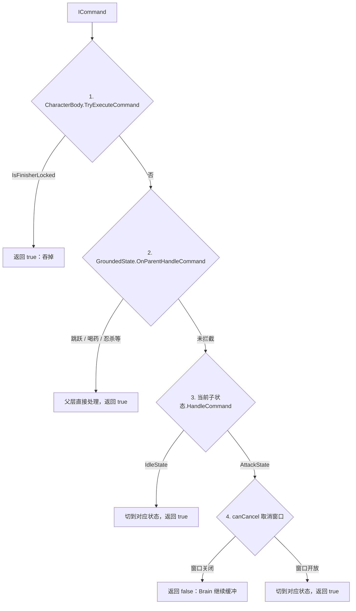

## 1. HFSM 的结构与三个基础类

### 1. 为什么要分层
角色的地面动作（待机、移动、攻击、防御、垫步）有一批共同的外部条件：离开地面要切到空中、喝药和跳跃要统一处理、演出期间要吞掉输入。如果所有状态都放在同一层，这些规则要在每个状态里各写一遍。

本项目的做法是用两层状态机：

- 顶层 `MainStateMachine` 管角色处在什么大环境（地面、空中、受击硬直、死亡）；
- 地面、空中等父状态自己再持有一台子状态机，管具体动作。地面公共规则写在父状态里，子状态只处理自己的动作。

```text
CharacterBody
  └─ MainStateMachine                    顶层状态机
      ├─ GroundedState（父状态）         地面公共规则：离地检测、跳跃、喝药
      │    └─ SubStateMachine            地面子状态机
      │         ├─ IdleState             待机
      │         ├─ MoveState             移动
      │         ├─ AttackState           攻击
      │         ├─ DeflectState          格挡 / 弹反
      │         ├─ DodgeState            垫步
      │         ├─ HealState             喝药
      │         └─ StaggerBrokenState / ParriedState 等
      ├─ AirState（父状态）              空中，同样带子状态机
      ├─ StunnedState（父状态）          受击硬直
      └─ DeadState（父状态）             死亡
```

整套机制只依赖三个类：`BaseState`、`StateMachine`、`HierarchicalState`。

---

### 2. BaseState：所有状态的基类
```csharp
// BaseState.cs
public abstract class BaseState
{
    // 状态通过所属角色访问组件、配置和状态切换入口。
    protected CharacterBody body;

    public BaseState(CharacterBody body)
    {
        this.body = body;
    }

    // ChangeState 时旧状态先 OnExit，新状态再 OnEnter；每帧只更新当前状态的 OnUpdate。
    public virtual void OnEnter() { }
    public virtual void OnUpdate() { }
    public virtual void OnExit() { }

    // true 表示已消费命令，Brain 可清掉对应缓冲；不保证实际执行了动作（也可能主动丢弃）。
    // false 表示本状态未消费，Brain 可在缓冲有效期内重试；本类不管理输入缓冲。
    public virtual bool HandleCommand(ICommand cmd)
    {
        return false;
    }

    // true 表示状态已处理本次命中，上层不再重复结算；false 交由角色统一扣血并切入受击。
    public virtual bool OnHitReceived(HitData hit)
    {
        return false;
    }
}
```

基类规定了每个状态的四个入口：进入、更新、退出、处理指令，另有一个处理受击的入口（章节 5 会用到）。默认实现都是空的或返回 `false`，子类按需重写。

---

### 3. StateMachine：只管切换，不判断条件
```csharp
// StateMachine.cs（节选）
public class StateMachine
{
    // 每个 StateMachine 只持有本层的当前状态；父状态内部另有一台子状态机。
    public BaseState CurrentState { get; private set; }
    public BaseState PreviousState { get; private set; }
    // ……调试路径、切换原因、切换次数等字段略

    // null 表示清空当前状态；切换始终先退出旧状态，再进入新状态。
    // 即使传入的是同一实例也会重新退出/进入，因此可让缓存的待机状态重置自身数据。
    public void ChangeState(BaseState newState, string reason = null)
    {
        BaseState previous = CurrentState;
        // 先保存旧路径，再执行 OnExit。父状态的 OnExit 会清空子状态机，
        // 不能等退出后再通过对象反推完整路径。
        PreviousStatePath = ResolveDebugPath(previous);
        previous?.OnExit();
        PreviousState = previous;
        CurrentState = newState;
        LastChangeReason = string.IsNullOrEmpty(reason) ? "unspecified" : reason;
        // 父状态会在 OnEnter 中建立初始子状态，之后再记录完整调试路径。
        CurrentState?.OnEnter();
        CurrentStatePath = ResolveDebugPath(CurrentState);
        TransitionCount++;
        onStateChanged?.Invoke(previous, CurrentState, LastChangeReason);
    }

    public void Update()
    {
        CurrentState?.OnUpdate();
    }

    public bool HandleCommand(ICommand command)
    {
        // 不排队、不解释命令，只转交当前状态；玩家输入缓冲由 Brain 维护。
        return CurrentState != null && CurrentState.HandleCommand(command);
    }
}
```

`StateMachine` 本身不知道任何业务条件，什么时候切、切到哪个状态由调用方决定。顶层和各个子状态机用的是同一个类。

---

### 4. HierarchicalState：带子状态机的父状态
```csharp
// HierarchicalState.cs
public abstract class HierarchicalState : BaseState
{
    // 每个父状态独立持有自己的子状态机。
    public StateMachine SubStateMachine { get; private set; }

    public HierarchicalState(CharacterBody body) : base(body)
    {
        // 子状态切换也回报给 CharacterBody，这样调试快照能显示完整路径。
        SubStateMachine = new StateMachine(
            (previous, current, reason) => body.NotifyStateChanged(this, previous, current, reason),
            state => body.GetStatePathForDebug(this, state));
    }

    // 要求子类必须提供一个默认进入的子状态
    protected abstract BaseState GetInitialSubState();

    public override void OnEnter()
    {
        // 自动切入默认子状态
        BaseState initial = GetInitialSubState();
        if (initial != null)
        {
            SubStateMachine.ChangeState(initial, "parent: enter initial child");
        }
    }

    public override void OnUpdate()
    {
        // 如果父状态自己没被切走，就驱动当前的子状态更新
        SubStateMachine.Update();
    }

    public override void OnExit()
    {
        // 离开父状态也必须退出子状态，让攻击关判定、喝药清动画层等收尾有机会执行。
        SubStateMachine.ChangeState(null, "parent: exit child");
    }

    // 父层先处理跨子状态规则，未消费的命令再交给当前叶子。
    public override bool HandleCommand(ICommand cmd)
    {
        // 先应用父状态的公共限制。
        if (OnParentHandleCommand(cmd))
        {
            return true;
        }

        // 未拦截时交给当前子状态。
        if (SubStateMachine.CurrentState != null)
        {
            return SubStateMachine.CurrentState.HandleCommand(cmd);
        }

        return false;
    }

    // true 在父层消费并停止下传；false 继续问子状态，并不是立刻返回给 Brain。
    protected virtual bool OnParentHandleCommand(ICommand cmd)
    {
        return false;
    }

    // 受击的转发方式与指令相同：先 OnParentHandleHit，未拦截再交给当前子状态。
    // （OnHitReceived / OnParentHandleHit 的具体实现略，受击裁决见章节 5）
}
```

`HierarchicalState` 在 `BaseState` 的基础上把每个入口都向下转发：

| 入口 | 父状态的处理 |
| :--- | :--- |
| `OnEnter` | 进入默认子状态 |
| `OnUpdate` | 驱动子状态机 |
| `OnExit` | 先让子状态机退出当前子状态 |
| `HandleCommand` | 先问父层的 `OnParentHandleCommand`，没拦截再交给子状态 |
| `OnHitReceived` | 先问父层的 `OnParentHandleHit`，没拦截再交给子状态 |

---

## 2. 状态机怎样启动与切换

### 1. 启动时的状态装配
角色在 `Awake` 里只创建 `MainStateMachine`，状态在 `Start` 里才进入：

```text
CharacterBody.Awake()
  └─ MainStateMachine = new StateMachine(...)        只创建，CurrentState 仍为空
CharacterBody.Start()
  └─ EnterGrounded()
      └─ MainStateMachine.ChangeState(SharedGrounded)
          └─ GroundedState.OnEnter()                 即 HierarchicalState.OnEnter
              └─ SubStateMachine.ChangeState(GetInitialSubState())
                  └─ IdleState.OnEnter()             默认进入待机
```

```csharp
// CharacterBody.cs
private void Awake()
{
    // ……组件获取等其他初始化略
    // 这里只创建状态机；两个回调用于调试，当前状态要到 Start 才设置。
    MainStateMachine = new StateMachine(NotifyStateChanged, GetStatePathForDebug);
}

private void Start()
{
    // ……
    // 地面父状态进入后，会在自己的子状态机中进入默认 IdleState。
    EnterGrounded("lifecycle: initial grounded");
}

public void EnterGrounded(string reason = "enter grounded")
{
    MainStateMachine.ChangeState(SharedGrounded, reason);
}

private GroundedState sharedGrounded;
public GroundedState SharedGrounded => sharedGrounded ??= new GroundedState(this);
```

```csharp
// GroundedState.cs
// 强制切入可指定初始子状态；null 表示使用默认待机。
private readonly BaseState forcedInitialSubState;

// 默认待机随父状态缓存，重复进入时通过 OnEnter 重置，减少回待机时的对象创建。
private IdleState cachedIdleSubState;

// HierarchicalState.OnEnter 调用这里，再让子状态机进入返回的状态。
protected override BaseState GetInitialSubState()
{
    return forcedInitialSubState ?? (cachedIdleSubState ??= new IdleState(body, this));
}
```

---

### 2. ChangeState 的执行顺序
顶层状态机切环境和子状态机切动作，调用的都是 `StateMachine.ChangeState(newState, reason)`，顺序固定：

1. 保存旧状态的调试路径；
2. 调用旧状态的 `OnExit()`；
3. 更新 `PreviousState / CurrentState`，记录切换原因；
4. 调用新状态的 `OnEnter()`（如果是父状态，会在这里进入它的默认子状态）；
5. 记录新路径、累加切换次数、触发 `onStateChanged` 回调。

有两点需要注意：

- 传入 `null` 表示清空当前状态，只会执行旧状态的 `OnExit`。父状态退出子状态就是这样做的（见第 4 章）；
- 传入同一个实例也会走完整的退出和进入。`GroundedState` 缓存了一个 `IdleState`，每次回到待机都会重新调用它的 `OnEnter` 来重置数据，不必每次 `new`。

---

## 3. 一条指令怎样被处理

### 1. 四级分流
上一章讲过，`BrainBase.ProcessCommandBuffer` 每帧把缓冲池里的指令交给 `body.TryExecuteCommand`。指令从这里开始，依次经过四个位置，在其中一个被消费或拒收：



返回值的含义由 `BaseState.HandleCommand` 的注释规定：

- `true`：指令已被消费，Brain 清掉缓冲。这不代表动作一定执行了，也可能是主动丢弃；
- `false`：本状态没有消费，Brain 在缓冲有效期（默认 0.2s）内继续重试。

---

### 2. 第一级：CharacterBody.TryExecuteCommand
```csharp
// CharacterBody.cs
// Brain（玩家输入或 Boss 决策）统一从这里交命令，再由状态机询问当前状态。
// true 只表示命令已消费；例如演出锁期间直接吞掉命令，角色不会实际执行它。
public bool TryExecuteCommand(ICommand cmd)
{
    if (IsFinisherLocked)
        return true;

    // true 表示某层已消费命令，false 表示当前层级未接受、可由大脑保留缓冲重试。
    return MainStateMachine.HandleCommand(cmd);
}
```

处决演出期间直接返回 `true`。这样玩家在演出中按下的攻击键会被当作已消费清掉，不会留在缓冲池里，等演出结束后突然打出一刀。

---

### 3. 第二级：父状态拦截（GroundedState.OnParentHandleCommand）
`MainStateMachine.HandleCommand` 把指令交给当前顶层状态 `GroundedState`，即 `HierarchicalState.HandleCommand`，它先调用 `OnParentHandleCommand`：

```csharp
// GroundedState.cs
protected override bool OnParentHandleCommand(ICommand cmd)
{
    // 这里返回 false 只是父层不消费，HierarchicalState 还会继续问当前子状态。
    // 最终是否保留 Brain 的输入缓冲，要看整个父/子调用链的返回值。
    // 忍杀 / Elbow 投技：父层也吞掉喝药，不能把演出切走。
    if (body.IsFinisherLocked)
    {
        return true;
    }

    // 崩解倒地由 StaggerBrokenState 吞命令。父层若先切喝药，
    // RecoverFromBreak 永远不会跑，架势条会卡满且无法忍杀。
    if (body.IsPostureBroken)
    {
        return false;
    }

    // 被弹开硬直：葫芦在父层会强切，必须留给 ParriedState 吞掉。
    if (body.IsParried)
    {
        return false;
    }

    // 喝药期间只有移动会下钻到 HealState；跳跃和重复喝药在父层直接吞掉。
    if (body.IsHealing && (cmd is JumpCommand || cmd is HealCommand))
    {
        return true;
    }

    // 攻击后摇开放前，父层不代为执行跳跃/喝药，继续交攻击叶子按自己的规则处理。
    if (body.IsAttacking &&
        !body.IsAttackRecoveryOpen &&
        (cmd is JumpCommand || cmd is HealCommand))
    {
        return false;
    }

    // 拦截跳跃指令
    if (cmd is JumpCommand)
    {
        if (!body.UsesAirState)
        {
            return true;
        }

        body.QueueJump();
        // QueueJump 已写入竖直速度，并预约 FixedUpdate 补写；随后切到空中父状态。
        body.EnterAirborne("command: jump");
        return true;
    }

    // 通过上面的公共限制后，由父状态统一处理喝药，避免每个叶子重复实现。
    if (cmd is HealCommand)
    {
        SubStateMachine.ChangeState(new HealState(body, this));
        return true;
    }

    // 只有在崩解机会已经出现后新按的攻击键才会生成 FinisherCommand。
    // 普通 AttackCommand 即使仍在连招缓冲中，也绝不能因本刀把 Boss 打崩而变成忍杀。
    if (cmd is FinisherCommand)
    {
        if (body.Faction == Faction.Player)
            CombatManager.Instance.TryExecuteAvailableFinisher(body);
        return true;
    }

    // Boss 已可忍杀时残留的普通攻击预输入直接丢弃，不能再落到 Idle/Move 开一刀。
    if (cmd is AttackCommand &&
        body.Faction == Faction.Player &&
        CombatManager.Instance.HasAvailableFinisher(body))
    {
        return true;
    }

    return false;
}
```

这个方法可以按顺序分成两段来读：

1. **先判断当前是否有特殊状态需要让路**（前五个 `if`）：演出锁、崩解倒地、被弹开、喝药中、攻击尚未进入后摇。有的返回 `true` 吞掉指令，有的返回 `false` 把指令留给对应的子状态处理；
2. **再处理需要父层统一负责的指令**：跳跃、喝药、忍杀，以及忍杀机会出现后残留的普通攻击。其余指令返回 `false`，由子状态处理。

以跳跃为例：它会让角色从地面环境切换到空中环境，属于顶层状态的切换。把它放在 `GroundedState` 里处理，待机、移动、攻击等子状态就不用各自实现跳跃。处理完返回 `true`，指令不会再传给子状态。

---

### 4. 第三级：子状态自治（IdleState.HandleCommand）
父层返回 `false` 后，`HierarchicalState` 调用 `SubStateMachine.CurrentState.HandleCommand(cmd)`。以待机状态为例：

```csharp
// IdleState.cs
public override bool HandleCommand(ICommand cmd)
{
    // 地面父层先处理跳跃、喝药等公共命令；到达这里的命令只决定当前地面动作。
    if (cmd is MoveCommand moveCmd)
    {
        // 忽略死区内输入，避免原地反复进入移动状态。
        if (moveCmd.Direction.sqrMagnitude > 0.01f)
        {
            body.MoveDirection = moveCmd.Direction;
            bool locked = LockOnManager.Instance != null && LockOnManager.Instance.IsLockedOn
                && LockOnManager.Instance.Target != null;
            string enter = locked ? "IdleToStrafe" : "IdleToWalk";
            parent.SubStateMachine.ChangeState(new MoveState(body, parent, enter));
        }

        // 死区内输入也视为已消费，避免缓冲反复重试。
        return true;
    }

    if (cmd is AttackCommand)
    {
        // AttackCommand 只有“想攻击”的含义；具体哪一招由 CharacterBody 的配置入口提供。
        parent.SubStateMachine.ChangeState(new AttackState(body, parent, body.GetAttackConfig()));
        return true;
    }

    if (cmd is DeflectCommand deflectCmd)
    {
        // 将真实按下的 PressId 继续传递，DeflectState 真正进入时才开启弹反窗口。
        parent.SubStateMachine.ChangeState(
            new DeflectState(body, parent, pressId: deflectCmd.PressId));
        return true;
    }

    if (cmd is DodgeCommand)
    {
        parent.SubStateMachine.ChangeState(new DodgeState(body, parent));
        return true;
    }

    return false;
}
```

待机状态对移动、攻击、防御、垫步都是直接切换到对应状态，并返回 `true`。切换通过 `parent.SubStateMachine` 完成，因为待机状态和目标状态属于同一台子状态机。

---

### 5. 第四级：动作中的取消窗口（AttackStateBase.HandleCommand）
如果当前子状态是 `AttackState`，同样一条指令的处理方式就不同了：

```csharp
// AttackStateBase.cs
public override bool HandleCommand(ICommand cmd)
{
    // 前摇可以主动取消；命中段锁定；进入后摇后重新开放所有非攻击行为。
    // 此处只计算能否取消；具体能取消到什么动作，由地面/空中派生类实现。
    bool canCancel = animTime < config.HitStartTime ||
                     animTime >= config.RecoveryWindowStart;

    if (cmd is DeflectCommand deflectCmd) return CancelToDeflect(canCancel, deflectCmd);
    if (cmd is DodgeCommand) return CancelToDodge(canCancel);
    if (cmd is FinisherCommand) return HandleFinisherCommand();
    if (cmd is AttackCommand) return HandleAttackCommand();
    if (cmd is JumpCommand) return HandleJumpCommand(canCancel);
    if (cmd is MoveCommand moveCmd) return HandleMoveCommand(moveCmd);
    return false;
}
```

```csharp
// AttackState.cs（地面子类）
protected override bool CancelToDodge(bool canCancel)
{
    if (!canCancel) return false;
    parent.SubStateMachine.ChangeState(new DodgeState(body, parent), "attack: cancel to dodge");
    return true;
}
```

以 `atk1`（`HitStartTime = 0.23`，`RecoveryWindowStart = 0.5`）为例：

| 玩家按下闪避的时刻 | `canCancel` | 结果 |
| :--- | :--- | :--- |
| 0.10s（前摇） | true | 立即切到 `DodgeState`，返回 `true` |
| 0.30s（命中段） | false | 返回 `false`，指令留在 Brain 缓冲池里 |
| 缓冲期间到达 0.50s | true | Brain 下一次重试时切到 `DodgeState`，返回 `true`，清空缓冲 |
| 缓冲到期（0.2s）时仍未到 0.50s | false | 指令被丢弃 |

同样是“按下闪避”，待机时直接切换，攻击时要看动画时间点。命中段不能取消，保证一刀打出来后不会被随手一按闪避中断。

再对比一下跳跃：

- 命中段内：父层第 5 条规则 `IsAttacking && !IsAttackRecoveryOpen` 返回 `false`，指令下到 `AttackStateBase.HandleCommand`，调用 `HandleJumpCommand(canCancel)`。地面攻击没有重写它，默认返回 `false`，指令留在缓冲池；
- 后摇开放后：`IsAttackRecoveryOpen` 为 `true`，父层不再让路，直接走跳跃拦截，切到 `AirState`，指令不会下到攻击状态。

---

## 4. 级联退出：切换环境时子状态的收尾

### 1. 问题
攻击中的判定由 `AttackState` 开启、关闭。但攻击状态是地面父状态的子状态，顶层环境可能在攻击中途被切走：

- 玩家被击中，主状态机切到 `StunnedState`；
- 角色走出地面，`GroundedState.OnUpdate` 调用 `EnterAirborne` 切到 `AirState`；
- 角色死亡，切到 `DeadState`。

如果只切顶层状态，不通知正在运行的 `AttackState`，Hitbox 就会一直开着。

---

### 2. HierarchicalState.OnExit 向下传递退出
```csharp
// HierarchicalState.cs
public override void OnExit()
{
    // 离开父状态也必须退出子状态，让攻击关判定、喝药清动画层等收尾有机会执行。
    SubStateMachine.ChangeState(null, "parent: exit child");
}
```

主状态机切换顶层状态时，会先调用旧顶层状态的 `OnExit`。`GroundedState` 没有重写它，执行的是 `HierarchicalState.OnExit`，它把子状态机切到 `null`，于是当前子状态的 `OnExit` 也被调用：

```text
MainStateMachine.ChangeState(new StunnedState(...))     以受击为例
  └─ GroundedState.OnExit()                             HierarchicalState.OnExit
      └─ SubStateMachine.ChangeState(null)
          └─ AttackStateBase.OnExit()                   当前子状态是攻击时
```

攻击状态的 `OnExit` 负责收尾：

```csharp
// AttackStateBase.cs
public override void OnExit()
{
    // 正常结束和被打断都会经过这里，必须关掉判定，避免离开攻击后仍能打中别人。
    body.DisableWeaponHit();
    body.ActiveHitPulseIndex = -1;
    body.IsAttackRecoveryOpen = false;
    body.AttackUninterruptible = false;
    body.SetSuppressRootYaw(false);
}
```

不管是动作自然结束、被取消，还是被顶层状态切走，旧状态都会走 `StateMachine.ChangeState` 里的 `previous?.OnExit()`，所以各状态可以把自己的清理集中写在 `OnExit` 里。`OnExit` 里每一项的含义见下一章（章节 4：一次攻击怎样从开始到结束）。
