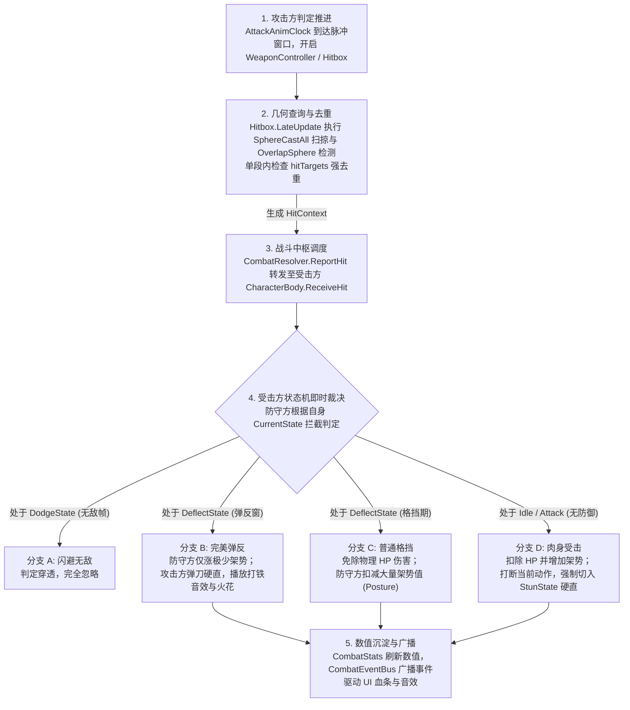

## 1. 攻防对抗核心闭环：从物理扫掠到受击裁决

《只狼》战斗系统中最核心的设计原则是：**物理检测与伤害裁决严格分离，接触不等于扣血**。物理判定只负责提供“碰到了谁”的客观几何事实，受击方状态机拥有完全的防御裁决主导权：



```text
【命中裁决调用链全景】
Hitbox.LateUpdate()
  ├─ 1. OverlapSphere / SphereCastAll 获取碰撞体
  ├─ 2. 过滤自身 Hurtbox 与当前段已命中目标 (hitTargets.Add)
  └─ 3. CombatResolver.ReportHit(context)
           └─ 防守方 CharacterBody.ReceiveHit(context)
                ├─ [分支 A: 无敌] CurrentState is DodgeState.IsInvulnerable -> return false
                ├─ [分支 B: 弹反] CurrentState is DeflectState.TryDeflect -> 触发双方弹刀反应
                ├─ [分支 C: 格挡] CurrentState is DeflectState.TryBlock -> 扣架势免伤
                └─ [分支 D: 受击] CombatStats.ApplyDamage() -> MainStateMachine.ChangeState(StunState)
```

## 2. 物理检测与防漏判去重机制（Hitbox）

### 1. 为什么采用 SphereCastAll 扫掠 + OverlapSphere 重叠双重检测？
- **高速挥刀穿模问题**：在帧率波动或高速挥刀时，前一帧刀尖在目标左侧，后一帧刀尖已瞬移到目标右侧。传统的单一碰撞体重叠（Overlap）会直接漏判。
- **贴身与起始点重叠问题**：`SphereCastAll` 是发射球体扫掠，如果目标一开始就与刀身根部重叠，射线扫描无法检测到起点重叠。
- **解决方案：双轨互补检测**：
  ```csharp
  // Hitbox.LateUpdate 核心逻辑
  void LateUpdate()
  {
      if (!isHitActive) return;

      // 1. 先用 OverlapSphere 覆盖起始点重叠与贴身判定
      FillOverlapping(startPoint, radius);

      // 2. 再用 SphereCastAll 沿上一帧到当前帧的位移轨迹进行体积扫掠
      Vector3 sweepDir = currentPoint - prevPoint;
      float sweepDist = sweepDir.magnitude;
      if (sweepDist > 0.001f)
      {
          RaycastHit[] hits = Physics.SphereCastAll(prevPoint, radius, sweepDir.normalized, sweepDist, hitLayer);
          foreach (var hit in hits) TryHit(hit.collider);
      }
      prevPoint = currentPoint;
  }
  ```

### 2. 攻击段内的单次命中去重（`hitTargets`）
- **痛点**：挥刀判定窗口持续 0.27 秒（跨越十几帧）。如果不做去重，同一刀扫掠中目标每帧都会被判定一次，导致瞬间多段扣血秒杀。
- **实现机制**：
  - `Hitbox` 内部维护一个 `HashSet<CharacterBody> hitTargets`；
  - 每一帧检测到碰撞体后，通过 `Hurtbox.Owner` 提取角色，先判断 `hitTargets.Contains(target)`；
  - 只有不在集合中的新目标才执行 `hitTargets.Add(target)` 并上报命中；
  - **清空时机**：仅在招式进入下一个打击脉冲（Pulse）或武器判定关闭（`DisableWeaponHit`）时，才清空 `hitTargets`，确保挥一次刀对一个目标只生效一次。

## 3. 防御状态机即时裁决：四路分支详解

当命中事件通过 `CombatResolver` 送达目标的 `CharacterBody.ReceiveHit(HitContext ctx)` 时，受击方状态机按照严格的优先级进行过滤：

### 1. 分支 A：闪避无敌帧（`DodgeState`）
- 垫步闪避启动时，配置赋予前 0.2 秒无敌标记（`IsInvulnerable = true`）；
- `ReceiveHit` 优先检测此标记：直接返回 `false`，判定完全穿透，不造成任何硬直与数值扣减。

### 2. 分支 B：完美弹反（`DeflectState` 弹反窗口期）
- 玩家在受到攻击前 0.15 秒内按下防御键，`DeflectState` 处于完美弹反窗口；
- **裁决结果**：
  - 受击方免除所有生命值伤害，仅增加微量架势值（且绝不会因弹反发生架势崩解）；
  - 攻击方被弹开，强制切入被弹反硬直状态（`DeflectRecoilState`），攻击节奏被强行打断；
  - 触发 `CombatEventBus` 广播弹刀事件，生成刺眼火花与高抗阻铁音。

### 3. 分支 C：普通格挡（`DeflectState` 持续防御期）
- 玩家提前按住防御键超过 0.15 秒，处于常规格挡姿态；
- **裁决结果**：
  - 免除所有生命值物理伤害；
  - 防守方承受全额架势伤害（Posture Damage），架势条急剧上升；若此时架势打满，当场进入架势崩解瘫痪（`PostureBroken`）。

### 4. 分支 D：肉身受击（无防御或后背受击）
- 防守方处于待机、移动或挥刀前摇中，毫无防御准备；
- **裁决结果**：
  - `CombatStats.ApplyDamage` 扣除全额生命值与架势值；
  - 强制打断防守方当前动作，主状态机调用 `ChangeState(new StunState(body, hitLevel))` 进入受击硬直；
  - 广播受击音效与流血特效。

## 4. 数值沉淀与表现广播解耦（CombatStats & EventBus）

战斗裁决产生结果后，底层数值与上层表现严格通过事件总线解耦，实现单向依赖：

```text
CombatResolver (中枢裁决)
  │
  ├─ 1. 防守方 CombatStats.TakeDamage(damage, posture)
  │       ├─ currentHP -= damage
  │       ├─ currentPosture += posture
  │       └─ 检查 currentPosture >= maxPosture ───> 触发 OnPostureBroken 回调
  │
  └─ 2. 静态事件广播: CombatEventBus.Publish(...)
          ├─ UI 监听: CombatUIController 更新血条与架势条残影
          ├─ 音效监听: AudioManager 播放打击、闷响或完美打铁音效
          └─ 特效监听: HitEffectSpawner 在接触点生成刀光粒子
```

- **单向解耦价值**：战斗底层（`CombatStats / Hitbox`）完全不引用任何 UI 或音频组件，就算完全关闭 UI 和音效，战斗数值与裁决逻辑也能 100% 独立稳定运行。
