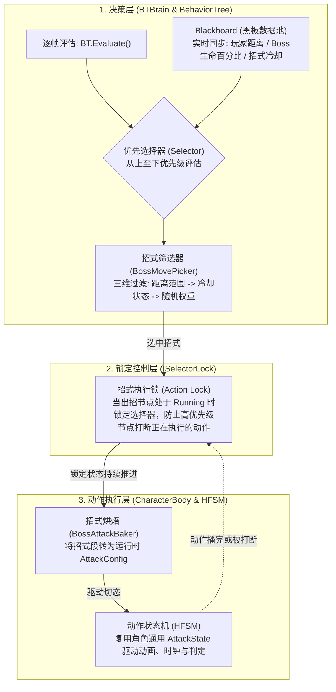

## 1. AI 决策与动作执行的双层解耦架构

在《只狼》Boss 战中，Boss 的行动由 **轻量行为树（Behavior Tree）** 与 **分层动作状态机（HFSM）** 协同驱动。两者职责明确、分工解耦：



```text
【Boss 决策与执行调用链全景】
BTBrain.Update()
  └─ RootSelector.Evaluate()
       ├─ [检查锁定] ISelectorLock.IsLocked == true -> 直接续跑当前正在执行的招式节点
       └─ [无锁评估] 依次评估各子分支:
            ├─ 1. 特殊反制分支 (如: 玩家喝药惩罚 HealPunish / 危字突刺识破)
            ├─ 2. 防守反击分支 (弹刀后的反击调度)
            └─ 3. 常规出招分支 (BT_PickActive -> BossMovePicker)
                 ├─ 步骤 A: 过滤距离与冷却 (Distance & CD)
                 ├─ 步骤 B: 权重轮盘赌选择候选招式
                 └─ 步骤 C: BT_ExecuteMove 启动招式并施加 SelectorLock
                      └─ BossAttackBaker.Bake() -> 提交给 HFSM 执行挥刀
```

## 2. 招式选择算法：三维过滤机制（BossMovePicker）

Boss 在进入出招决策时，绝不是随意随机出招，而是通过 `BossMovePicker` 严格执行三步筛选：

### 1. 距离匹配过滤（Range Filter）
- 从黑板读取当前与玩家的真实欧几里得距离 `distToTarget`；
- 遍历招式表，剔除不满足 `[minDistance, maxDistance]` 区间的招式（例如：玩家处于 8 米外远距离时，剔除贴身横扫，仅保留远距离突刺或飞冲）。

### 2. 冷却时间戳过滤（Cooldown Filter）
- 黑板 `Blackboard` 为每个招式记录上次释放完成的时间戳 `lastUsedTime`；
- 检查 `Time.time >= lastUsedTime + config.Cooldown`；
- 仍在冷却期内的强力连招被直接剔除，防止 Boss 连续复读同一大招。

### 3. 权重轮盘赌随机（Weighted Random Pick）
- 经过前两轮筛选后，剩余的有效招式进入候选池；
- 累加候选招式的 `Weight` 总和，生成随机数滚轮选择最终招式，实现 Boss 招式的动态变化与不可预测感。

## 3. 防频繁变招的锁定机制（`ISelectorLock`）

### 核心痛点
行为树通常每帧（或固定频率）自顶向下重新评估所有节点。如果 Boss 正在执行一段长达 1.5 秒的蓄力斩，下一帧因为玩家距离稍有变化，高优先级的“走位”或“变招”节点被满足，就会导致**Boss 动作被无故掐断、抽搐变招**。

### 解决方案：`ISelectorLock` 接口设计
- 当 `BT_ExecuteMove` 节点被激活开始挥刀时，该节点向父级 `Selector` 注册自己为活跃锁（`ActiveLock = this`）；
- 父级 `Selector` 在后续帧评估时，先检查是否存在未释放的锁：
  ```csharp
  // Selector.cs 评估逻辑片段
  public override NodeState Evaluate()
  {
      if (activeLock != null && activeLock.IsLocked)
      {
          // 锁定期间跳过其他高优先级子节点，无条件继续执行锁定节点
          return activeLock.ExecuteLockedNode();
      }

      // 无锁时才正常从上至下遍历子节点
      foreach (var child in children) { ... }
  }
  ```
- **释放锁的时机**：
  1. 招式正常播放收尾完毕；
  2. Boss 被玩家完美弹刀打入强制硬直；
  3. Boss 被击飞离地或被打断。
  此时节点调用 `Unlock()`，选择器恢复正常的自顶向下自由评估。

## 4. 动作烘焙与 HFSM 复用（BossAttackBaker）

Boss 的行为树不直接操作底层的 Animator 骨骼动画，而是通过 `BossAttackBaker` 与通用角色动作框架对接：

```text
BossMoveTable (招式资产)
  │ (包含招式动画、位移速度、伤害、脉冲区间)
  ▼
BossAttackBaker (动态烘焙器)
  │ 将招式条目转化为与玩家完全相同的 AttackConfig
  ▼
CharacterBody.MainStateMachine
  │
  └─ GroundedState.SubStateMachine.ChangeState(new AttackState(body, config))
```

- **架构复用价值**：
  Boss 的出招最终也是转化为 `AttackConfig` 并进入 `AttackState`。这意味着：**Boss 的挥刀同样享有纯代码时钟 `AttackAnimClock` 读取、同样的 `SphereCastAll` 体积扫掠、同样的单段受击去重列表以及同样的级联退出保障**。
  整套物理判定与动作生命周期底层完全复用，没有为 Boss 编写任何冗余的重复代码。
