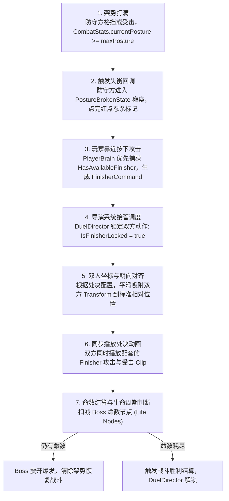

## 1. 架势崩解到忍杀处决的跨系统协同

《只狼》战斗的精髓在于“打满架势条即可触发忍杀处决，直接扣除一条命”。这涉及数值系统、双人演出调度以及全局生命周期的协作：



```text
【忍杀处决与生命周期调用链】
CombatStats.TakePostureDamage()
  └─ OnPostureBroken() 回调
       └─ Boss 切换至 PostureBrokenState (失衡瘫痪)
            │
            ▼ 玩家在有效距离按下攻击
PlayerBrain.OnAttackStarted()
  ├─ 检查: CombatManager.Instance.HasAvailableFinisher() == true
  └─ BufferCommand(new FinisherCommand())
       └─ CharacterBody.TryExecuteCommand(FinisherCommand)
            └─ DuelDirector.Instance.ExecuteFinisher(player, boss)
                 ├─ 1. player.IsFinisherLocked = boss.IsFinisherLocked = true (全锁死)
                 ├─ 2. 对齐双方 Transform 相对坐标与角度
                 ├─ 3. 双方同步 CrossFade 配套处决动画
                 ├─ 4. 关键帧触发命中与血雾音效
                 └─ 5. 扣减 Boss.LifeNodes -> 判断胜负或阶段转换
```

## 2. 处决演出锁机制（`IsFinisherLocked`）

### 1. 为什么需要演出锁？
处决演出属于极其严密的双人同步骨骼动作。如果在处决播放过程中，玩家狂按攻击或闪避，或者 Boss 受到环境物理推力，就会导致**双人穿模、动作错位或被其他指令强行打断切态**。

### 2. 锁定的三大维度实现
- **输入维度完全吞噬**：
  `CharacterBody.TryExecuteCommand` 检测到 `IsFinisherLocked` 时，**无条件返回 `true` 并直接丢弃任何输入**。这不仅封锁了动作切换，更防止了玩家狂按积累预输入导致的演出后“误出招”。
- **物理与移动维度冻结**：
  双方刚体进入 Kinematic 模式，阻断外力推力与重力干扰；
- **伤害维度无敌保护**：
  处决期间双方开启无敌保护，免疫外界其他碰撞体的命中结算。

## 3. 双人位置与旋转平滑对齐（Transform Snapping）

为了保证处决动作的刀尖严丝合缝地刺入 Boss 躯干，`DuelDirector` 负责在启动处决的前 0.1 秒内执行相对坐标对齐：

```csharp
// DuelDirector.cs 伪代码逻辑
public void AlignCombatants(CharacterBody attacker, CharacterBody victim, FinisherConfig config)
{
    // 1. 计算攻击者相对于受击者的理想世界坐标与朝向
    Vector3 targetPos = victim.transform.position + victim.transform.rotation * config.RelativeOffset;
    Quaternion targetRot = Quaternion.LookRotation(victim.transform.position - targetPos, Vector3.up);

    // 2. 极短时间内平滑插值吸附，消除玩家站在侧面或稍微靠后产生的错位
    attacker.transform.position = targetPos;
    attacker.transform.rotation = targetRot;
}
```

## 4. 战斗生命周期与场内快速复位（EncounterScope）

### 传统做法的痛点
在单局战斗失败重开时，许多项目直接调用 `SceneManager.LoadScene(currentScene)`。这会导致整个场景销毁、垃圾回收（GC）、重新加载所有资产，造成 **数秒的漫长黑屏卡顿**，严重破坏只狼高频重试的体验。

### 场内快速复位（In-Place Reset）架构
本项目通过 `EncounterScope` 实现了毫秒级的原地无缝复位：

```text
EncounterScope (对决管理器)
  │
  ├─ 1. 复位角色数值: CombatStats.ResetForEncounter() ─── 恢复满 HP、清空架势、重置命数
  ├─ 2. 复位状态机: MainStateMachine.ChangeState(new GroundedState()) ─── 回归初始待机
  ├─ 3. 复位 Boss 决策: BTBrain.ResetTree() ───────────── 清空黑板时间戳与招式锁
  ├─ 4. 复位空间位置: Transform.position = spawnPoint ──── 瞬移回各自对峙起点
  └─ 5. 复位表现层: CombatEventBus.Publish(ResetEvent) ─── UI 血条重置、音效停止
```

- **架构收益**：全过程无需重新加载任何场景资源，单局复位在 **1 帧内（16ms）完成**，玩家点击重开瞬间角色立即恢复对峙，体验丝滑流畅。
