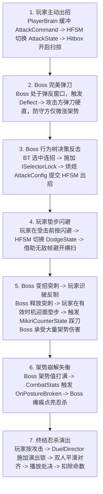

## 1. 攻防对抗全流程闭环串联

为了在面试中完整展现整个项目的协同运作，我们可以用一段最典型的战斗对抗切片，将整个架构融会贯通：

## 2. 简历五大核心要点标准面试表达模版

### 考点 1：角色控制架构（Command + HFSM）
- **面试官常问**：*“你的角色控制为什么采用 Command + HFSM 架构？相比常规写法有什么好处？”*
- **满分回答范式**：
  > “在复杂的 ARPG 中，如果采用传统的单层有限状态机（FSM），状态之间的跳转连线会呈指数级爆炸。
  > 我引入了 **分层状态机（HFSM）**，通过 `GroundedState`、`AirState` 等父状态统一收敛公共物理环境规则。例如在地面任何子状态按下跳跃，父状态直接截胡切到空中，无需在待机、移动、出招等每个子状态中重复写跳跃逻辑；同时通过基类 `HierarchicalState.OnExit()` 实现了**级联退出清理（Cascade Exit）**，确保角色被击飞或掉落平台时，底层正在挥刀的子状态能被强制注销，杜绝 Hitbox 残留。
  > 配合 **Command 模式**，输入不直接操作状态机，而是打包为对象化指令存入单槽预输入缓冲池（0.2s TTL）。这不仅实现了丝滑的预输入手感，更关键的是**统一了解耦了输入源**——玩家的按键输入与 Boss 行为树的动作请求，都统一作为 `ICommand` 送入状态机执行，底层的动作流转完全复用。”

### 考点 2：物理命中判定与防漏判去重
- **面试官常问**：*“你的近战打击判定是怎么做的？高速挥刀穿模和贴身漏判怎么解决？”*
- **满分回答范式**：
  > “我没有使用传统的物理碰撞体触发器（`OnTriggerEnter`），因为在帧率波动或高速挥刀时，极易发生穿模漏判。
  > 我们的解决方案是 **配置化攻击窗口 + 双轨几何查询**：
  > 1. 由 `AttackConfig` 配置打击脉冲区间（`hitPulses`），结合纯代码时钟 `AttackAnimClock` 精确在 `[0.23s, 0.50s)` 启停 Hitbox；
  > 2. 在物理查询上，我们在 `LateUpdate` 执行 **`SphereCastAll` 体积扫掠**，沿上一帧到当前帧的刀尖位移线段进行扫掠，彻底消除高速穿模；同时配合 **`OverlapSphere` 重叠检测**，覆盖刀身起始点重叠与贴身无相对位移的漏判；
  > 3. 为了防止一次挥刀十几帧内多次重复伤害同一个目标，我们在每个打击段内维护一个 `HashSet<CharacterBody>` 受击去重列表，确保单次挥刀对同一角色只判定一次，段落结束或关判定时立即清空。”

### 考点 3：攻防裁决与解耦机制（接触 $\neq$ 扣血）
- **面试官常问**：*“只狼里有格挡、弹反、闪避无敌和受击，命中检测和这些防御逻辑是怎么协同的？”*
- **满分回答范式**：
  > “我们的核心设计原则是：**物理检测与战斗裁决严格解耦，接触不等于扣血**。
  > `Hitbox` 只负责提供客观的碰撞事实，生成 `HitContext` 上报给全局中枢 `CombatResolver`，然后转发给防守方的 `CharacterBody.ReceiveHit`。
  > 裁决的主导权完全在受击方状态机：
  > 1. 若受击方处于 `DodgeState` 无敌帧，直接忽略判定；
  > 2. 若受击方在受击前 0.15s 按下防御，处于 `DeflectState` 弹反窗口，触发**完美弹反**：防守方免伤且仅微涨架势，攻击方被弹刀硬直，广播打铁音效；
  > 3. 若处于持续格挡期，免除 HP 伤害，消耗大量架势值；
  > 4. 若无防御，才扣减生命值并强制切入 `StunState` 受击硬直。
  > 这种设计使得攻击方无需关心目标如何防守，受击方根据自身状态自主裁决，代码高度解耦。”

### 考点 4：Boss 行为决策（行为树与 HFSM 的分工）
- **面试官常问**：*“Boss 的行为树和角色的动作状态机是怎么分工的？如何防止 AI 每帧评估导致动作被打断？”*
- **满分回答范式**：
  > “我们将 AI 严格拆分为两层：**轻量行为树负责‘大脑决策’，分层状态机负责‘身体动作执行’**。
  > 行为树通过 `BossMovePicker` 结合玩家距离、招式冷却戳和随机权重筛选招式。
  > 为了解决‘行为树逐帧评估导致当前攻击动作被高优先级节点频繁掐断’的经典痛点，我引入了 **`ISelectorLock` 招式锁机制**：
  > 当选定招式进入 `Running` 执行期时，出招节点锁定父级选择器；在动作播放完成前，选择器直接续跑当前节点，跳过高优先级抢占；只有动作播放完毕、或被玩家完美弹刀打断时，才释放锁恢复自由评估。
  > 最终招式由 `BossAttackBaker` 烘焙为标准 `AttackConfig`，复用底层的 `AttackState` 执行，实现了 AI 与玩家底层动作流水线的统一。”

### 考点 5：数据驱动与表现解耦
- **面试官常问**：*“战斗数值和表现层（UI、音效）是如何组织的？多个角色共享配置会串数据吗？”*
- **满分回答范式**：
  > “我们采用 **ScriptableObject 静态配置与运行时动态数据严格分离** 的策略。
  > 招式参数（`AttackConfig`）和角色基础属性（`CharacterConfig`）是只读的 ScriptableObject 资产；而运行时每个角色的当前生命值、架势条和状态回调，由各自身上的 `CombatStats` 独占实例维护。多角色共享同一份资产，内存开销极低且绝无数据污染。
  > 同时，战斗底层与表现层通过静态事件总线 `CombatEventBus` 广播解耦。数值发生变化时发布事件，UI 血条、音效池和粒子系统作为订阅者响应表现。就算完全剥离表现层，战斗逻辑依然可以 100% 独立稳定运行。”

## 3. 面试杀手锏：三大真实排错与避坑案例

在面试中，主动提及遇到的 Bug 以及如何排查解决，是证明代码 100% 亲自开发的最有力武器：

### 案例 1：动画事件丢帧导致的 Hitbox 无法关闭与残留 Bug
- **现象**：早期使用 Unity Animation Event 在动画开头和结尾触发 Hitbox 开启与关闭。在低帧率卡顿或角色在挥刀中途被弹反、击飞时，关闭事件未能触发，导致武器碰撞体永远留在场上，碰谁谁掉血。
- **排查与解决**：果断弃用动画事件，开发纯代码时钟 `AttackAnimClock`，通过 `normalizedTime * length` 轮询绝对秒数；并在 `HierarchicalState.OnExit` 中加入级联强制退出，只要状态被打断离开，强制注销武器 Hitbox，彻底根治。

### 案例 2：忍杀处决期间狂按输入导致的“演出后误出招”
- **现象**：Boss 进入失衡后触发忍杀，玩家在欣赏华丽处决演出期间习惯性连点轻攻击，导致处决刚播完，玩家立刻自动砍出一刀，打乱节奏甚至被起身 Boss 反打。
- **排查与解决**：排查发现虽然处决状态不能攻击，但单槽预输入缓冲池在 0.2s 内一直重试。于是在 `CharacterBody.TryExecuteCommand` 网关加入演出锁 `IsFinisherLocked` 判断：处决期间返回 `true` 并主动丢弃指令，既阻止了切态，又清空了预输入，保证演出结束后角色干净停在待机。

### 案例 3：高速挥刀与近身判定盲区
- **现象**：测试普通重劈时，近距离贴身面对 Boss 时有时无法命中，而高速横扫面对快速跑动的目标时出现穿模。
- **排查与解决**：定位到纯 `SphereCastAll` 对起始点完全重叠的目标无法生成 RaycastHit。改用“`OverlapSphere` 先查重叠 + `SphereCastAll` 扫掠位移”的双轨几何互补方案，并配合 `HashSet` 强去重，兼顾了贴身与高速场景的 100% 稳定命中。

## 4. 深度设计追问与架构疑难解答（技术取舍与答辩杀手锏）

以下汇总了开发与面试中涉及架构设计、C# 底层、Unity 引擎交互的最尖锐追问与标准解答：

### Q1：CharacterBody 目前被玩家和 Boss 共用，出现了如 `PreferFastWalk` 等只有 Boss 用的冗余字段，能否解耦成两个实现类和一个基类？
- **现状剖析**：  
  当前 `CharacterBody` 采用的是单体门面（Monolithic Facade）设计。优点是在系统初期降低了状态机、武器控制和战斗裁决的抽象成本（只认一个类型）；缺点是随着 Boss AI 复杂度上升，部分专属于 AI 寻路、仇恨的字段污染了核心门面，违反了**单一职责原则（SRP）**与**接口隔离原则（ISP）**。
- **重构方案取舍**：
  1. **方案 A（继承方式：`CharacterBodyBase`）**：
     提取 `CharacterBodyBase`（收敛 HFSM、Animator、CombatStats、WeaponController 等战斗共性），派生出 `PlayerBody` 与 `BossBody`（扩展 `PreferFastWalk`、阶段属性等）。缺点是 C# 单继承限制，且下游系统若需访问特定子类需频繁类型转换（Downcasting）。
  2. **方案 B（组合优于继承：组件装配，架构推荐）**：
     保持 `CharacterBody` 作为纯粹的物理与动作中枢，将 AI 寻路特异性参数剥离至独立的 `BossLocomotionAgent` 或挂载于 `BTBrain` 黑板中。`CharacterBody` 仅暴露标准的 `MoveDirection` 与 `MaxSpeedMultiplier`。
- **面试表达总结**：
  > “在敏捷开发初期，为了快速打通玩家与 Boss 共享同一套 HFSM、攻击时钟与受击裁决，共用 `CharacterBody` 保证了动作流水线的高度一致。针对目前出现的专有字段冗余，最佳重构方向不是简单继承，而是遵循‘组合优于继承’，将移动偏好等 AI 决策专属参数下沉至 `BTBrain` 或专职的 AI 运动代理组件中，保持核心门面的正交性与纯粹性。”

### Q2：Command 为什么用接口（`ICommand`）实现？结构体和接口配合的装箱（Boxing）怎么看？
- **为什么不用枚举？**  
  枚举只能表示状态类型，**无法携带上下文参数**。例如 `MoveCommand` 必须携带摇杆 `Vector2`，`DeflectCommand` 必须携带按键实例唯一的 `pressId`。对象化的命令是携带动态运行时参数的唯一优雅解法。
- **为什么用接口而不用抽象类？**  
  C# 是单继承语言。使用 `ICommand` 仅定义行为契约，不侵入类的继承树，任何结构体或类只要满足协议即可作为命令路由，解耦彻底。
- **结构体（struct）配合接口的装箱内存问题**：
  在 C# 中，如果将值类型 `struct AttackCommand` 赋值给引用类型 `ICommand bufferedCommand`，会不可避免地触发**装箱（Boxing）**，产生堆内存分配（GC Alloc）。
  - **工程现状**：由于单槽缓冲每 0.2s 仅触发一次输入，GC 压力极小；
  - **极致优化方案（0 GC 方案）**：在要求完全 0 GC 的严苛工程中，对于无状态参数的命令（如 `AttackCommand`、`JumpCommand`），可以将其改为不可变的引用类（`class`），并在内存中常驻一个静态只读单例（`public static readonly AttackCommand Instance = new()`），提交时直接复用该单例；或者通过统一抽象基类 `CommandBase` / 泛型缓冲彻底消除装箱。

### Q3：为什么不用 Unity 原生 Animation Event 实现 Hitbox 启停？
- **面试痛点揭秘**：
  1. **帧率波动丢事件**：Unity 动画事件是基于动画采样的。在帧率突降或动画播放速度（PlaySpeed）被脚本动态加速时，采样可能直接跳过事件标记帧，造成“开判定事件触发了，关判定事件漏掉了”，武器碰撞体永远开启；
  2. **被打断时无法兜底**：角色在挥刀途中若被敌人完美弹反、击飞受击或掉下悬崖，HFSM 会立即强行切换状态。此时由于动作被中途切走，后续帧上挂的“关闭 Hitbox 动画事件”**根本没有机会被 Unity 触发**，造成致命的判定残留 Bug；
  3. **资产维护脆弱**：动画 Clip 重新导入、重命名或动作融合过渡时，事件标记容易被冲掉，且程序员无法在代码中进行断点调试。
- **纯代码时钟 `AttackAnimClock` 的优势**：
  完全由 C# 状态机在 `OnUpdate` 中轮询绝对播放秒数，不受丢帧影响；且无论何种途径离开状态，`AttackStateBase.OnExit()` 都有 100% 触发的安全收尾，彻底消除了判定残留。

### Q4：状态机为什么不用 Unity 自带的 Animator 状态机（StateMachineBehaviour）？
- **职责混淆与黑盒不可控**：  
  Unity Animator 的底层是原生 C++ 动画混合管线，其状态切换由 CrossFade 融合曲线驱动。如果将复杂的攻击前摇取消、完美弹反判定、输入缓冲重试等业务逻辑写在 `StateMachineBehaviour` 中，执行时机受动画管线牵制，逻辑与美术表现严重耦合，且难以调试。
- **无法满足 HFSM 的分层裁决**：  
  Animator 无法优雅实现“父状态拦截跳跃并返回 false 向下放行给子状态”、“取消窗口动态裁决打断”等复杂控制流。
- **协作与版本管理灾难**：  
  Animator Controller 是庞大的 YAML/二进制资产，多人协作开发动作极易发生 Git 冲突且无法合并。
- **双状态机各司其职**：  
  纯 C# HFSM 做“大脑”（负责规则判定、判定窗口控制、状态流转），Unity Animator 做“肉体表现”（负责动作融合、根运动位移）。

### Q5：`hitPulses.end`（关判定）与 `RecoveryWindowStart`（开放后摇行为）本质是一样的吗？能合并为同一个吗？
- **核心结论**：**概念维度完全不同，绝对不能合并！**
- **本质区别**：
  - **`hitPulses.end` 是【物理判定维度】**：代表武器刀刃在空间中划过的有效杀伤时间结束（例如 0.50s 刀已经挥过，空间中不再产生命中）；
  - **`RecoveryWindowStart` 是【动作输入与控制节奏维度】**：代表该招式从何时开始允许玩家通过按闪避、防御打断后摇（Action Canceling）。
- **为什么不能合并？**：
  1. **硬直惩罚设计**：在重武器设计中（如巨剑大劈），刀在 0.50s 就砸到了地上（判定结束），但角色因惯性陷入硬直，必须惩罚性地僵直等待至 0.80s（`RecoveryWindowStart`）才允许翻滚取消。如果合并，判定一结束就能翻滚，动作节奏将毫无打击沉重感；
  2. **先行取消设计**：某些轻灵小刀招式，允许在判定即将结束前几毫秒就提前垫步取消；
  3. **多段判定招式**：一记双重回旋斩可能包含两个脉冲区间（`[0.2s, 0.4s]` 和 `[0.6s, 0.8s]`），有多个 `hitPulses.end`，但取消窗口只有一个。两者解耦是专业动作游戏设计的行业标准。

### Q6：`animTime = 0`（本次攻击的动画时间从零开始）不是完全多余的废话吗？
- **核心结论**：**绝不多余，这是极其严谨的防御性状态重置（State Hygiene）！**
- **深层避坑原因**：
  1. **防止跨状态时钟污染**：同一个 `AttackState` 实例可能被对象池复用，或者角色快速连招切入下一段。如果上一招的 `animTime` 停留在 `1.4s`，进入新招式若不显式重置为 `0`，首帧 `ApplyHitbox()` 比对时可能因旧时间直接落入新招式的脉冲区间，**导致第一帧瞬间误触发攻击判定**；
  2. **跨淡入融合期（CrossFade）保护**：当调用 `CrossFade` 时，Animator 状态机并非瞬间对齐，底层需要几帧完成权重过渡。在首帧动画底层状态尚未刷新完全时，手动赋 `animTime = 0` 保证了当前帧在纯代码逻辑层绝对处于“起手前摇、判定关闭”的干净零状态。

### Q7：为什么要写 `AnimUtil` 类？Unity 不是自带 API 用来查找路径吗？
- **Unity 原生 API 的两大硬伤**：
  1. **短名（ShortName）匹配缺陷**：Unity 原生 `animator.GetCurrentAnimatorStateInfo(layer).IsName("Attack1")` 内部依赖于完整的层级路径名（如 `Base Layer.Attack1`）。直接传短名 `"Attack1"` 在特定子状态机或层级下经常返回 `false`，非常容易引发 Bug；
  2. **过渡期（In Transition）的黑盒**：在两个动作平滑融合（CrossFade 0.15s）期间，同时存在当前状态和目标状态，原生 API 提取当前状态信息时极其混乱。
- **`AnimUtil` 的封装价值**：
  统一维护动画状态名到哈希（`Animator.StringToHash`）的内存缓存，避免运行期频繁进行字符串比对与 GC 分配；同时封装了平滑跨淡入逻辑（`TryBeginAttackAnim`），隔离了 Unity 动画底层混乱的哈希判定。

### Q8：`AttackAnimClock` 类是干啥的？Unity 没有提供 API 自己读取吗？
- **Unity 原生提供的局限**：  
  Unity Animator 仅提供 `stateInfo.normalizedTime`（归一化比例，0.0~1.0，但非单次播放时会持续累加至 2.5、3.5）和 `stateInfo.length`（Clip 单次绝对时长），**并没有一个直接告诉你“当前招式播放到了第几点几秒”的现成 API**。
- **`AttackAnimClock` 的核心使命**：
  1. **过渡期优先感知**：在发起 `CrossFade` 的过渡期内，`GetCurrentAnimatorStateInfo` 读到的其实还是**上一个动作（如待机）的时间**！`AttackAnimClock` 封装了逻辑：当检测到过渡发生时，自动转向 `GetNextAnimatorStateInfo` 提前提取目标招式的时间；
  2. **精准换算绝对秒数**：策划在 `AttackConfig` 中配置的是绝对时间（如 0.23s 开判定，0.50s 关判定），`AttackAnimClock` 负责将循环/非循环的归一化时间精准换算为绝对秒数：
     $$\text{animTime} = (\text{normalizedTime} \pmod 1) \times \text{length}$$
  3. 为整个战斗系统的打击窗口、音效触发、可取消后摇提供了唯一绝对确定性的逻辑基准时钟。

### Q9：`HasBufferedCommand<T> / DropBufferedCommand<T>` 为什么要用泛型约束 `where T : ICommand`？
- **强类型编译期安全**：避免传 `System.Type` 导致开发者误传入非 Command 类型；
- **消除反射开销**：在 C# 内部，使用 `bufferedCommand is T` 进行模式匹配，编译器会直接生成高效的底层 IL 类型检查指令，完全避免了在运行期调用 `bufferedCommand.GetType() == typeof(...)` 的反射开销。

### Q10：判定去重表 `hitTargets` 是在何时清空的？
- **时机一：脉冲切换时（Next Pulse）**：若一记挥刀为二段判定（例如回旋斩扫两圈），当第一段脉冲结束进入第二段脉冲时，清空去重列表，允许第二刀再次判定命中；
- **时机二：动作退出时（`OnExit` / `DisableWeaponHit`）**：动作结束收刀或中途被打断退出时，强行清空列表，保证下一次出招面对新敌人拥有干净的去重状态。
