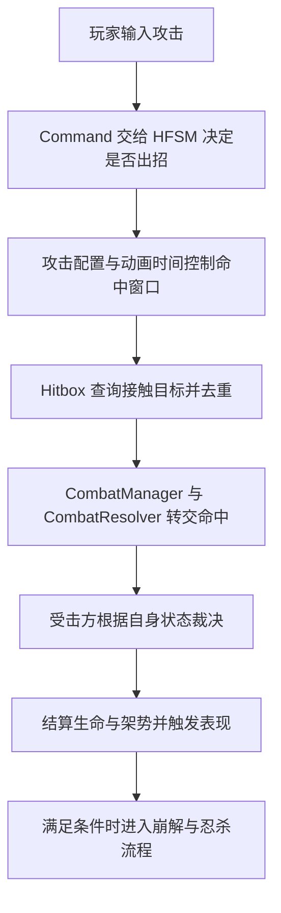

## 1. 一场战斗的流程串联

下面是一组可能发生的攻防片段，用来连接模块职责；不是每场战斗都必然依次发生的固定脚本。



| 战斗片段 | 主要交接 | 需要保留的条件 |
| --- | --- | --- |
| 玩家挥刀 | 输入 → 指令 → HFSM → 攻击配置 → Hitbox | 指令被消费不一定代表实际出招，例如演出锁可以直接吞掉指令 |
| Boss 完美弹反 | 命中上报 → 防御裁决 → 攻击方架势变化 | 普通近战完美弹反不增加防守方架势；攻击方是否进入弹刀硬直还受霸体、末刀等条件限制 |
| Boss 选择反击 | 行为树选招 → 招式配置转化 → 动作执行 | AI 决定做什么，HFSM 控制当前动作如何运行 |
| 玩家闪避或识破 | 闪避输入 → 对应动作与防御分支 | 是否避开或反制取决于窗口、攻击类型等条件，不能把所有闪避都视为免伤 |
| 架势崩解与忍杀 | 架势达到阈值 → 忍杀机会 → 处决演出 → 命数结算 | 出现机会不等于自动处决，还需要满足触发条件 |

## 2. 简历核心要点的表达与边界

### 2.1 角色控制：Command 与 HFSM

**常见问题：为什么采用 Command 与分层状态机？**

玩家输入与 Boss 常规动作请求通过命令接口交给角色，状态机决定当前是否接受。父层负责共享规则，子层负责当前动作的具体响应，可以减少不同动作中重复的规则判断。

玩家离散动作使用单槽预输入：新命令覆盖旧命令，默认有效期为 0.2 秒。暂时不能执行时逐帧重试，消费成功或超时后清空。连续移动与离散动作不应笼统描述成全部进入缓冲池。

**取舍：** 单槽实现简单，但不保存完整输入队列；接口统一了调用契约，但值类型转换为接口可能发生装箱。分层状态机减少公共规则重复，不意味着任意动作都能被父层无条件打断。

### 2.2 命中检测：时间窗口、三种查询与去重

**常见问题：怎样处理高速挥刀、贴身接触和重复结算？**

`hitPulses` 描述有效命中区间，动画时间决定判定是否开启。开启期间，`Hitbox` 使用三种查询：

| 查询 | API | 检测范围 |
| --- | --- | --- |
| 1：刀尖帧间扫掠 | `SphereCastAll` | 上一帧刀尖到当前帧刀尖之间的直线路径 |
| 2：刀尖当前重叠 | `OverlapSphereNonAlloc` | 当前刀尖周围的小球 |
| 3：刀身当前重叠 | `OverlapCapsuleNonAlloc` | 当前刀柄到刀尖之间的胶囊体 |

每个判定窗口用 `HashSet<CharacterBody>` 去重，同一角色有多个受击碰撞体也只上报一次。这里的“一次”是一次命中上报，并不保证扣血，因为后续仍可能被无敌、格挡或弹反处理。

**取舍：** 刀尖直线扫掠与当前刀身重叠提高覆盖，但不等于整把刀在两帧之间旋转扫过体积的精确连续检测。`SphereCastAll` 返回数组；两个 NonAlloc 查询复用固定缓冲区，不能据此声称整个检测流程零分配。具体用途与限制见 Q11～Q13。

### 2.3 攻防裁决：接触不等于扣血

**常见问题：碰撞检测怎样和格挡、弹反、闪避协同？**

检测层发现候选目标后，经 `CombatManager.ReportHit` 与 `CombatResolver.ReportHit` 转交受击方 `CharacterBody.ReceiveHit`。检测负责“接触了谁”，受击规则负责“这次接触如何处理”。

| 普通攻防情形 | 结果与条件 |
| --- | --- |
| 有效无敌或反制窗口 | 按当前防御规则拦截命中 |
| 普通近战完美弹反 | 防守方免伤且不涨架势，刷新战斗计时；攻击方增加架势，满足条件才被打断 |
| 可格挡攻击的普通格挡 | 不扣生命，按格挡系数增加架势 |
| 未被防御规则处理 | 进入伤害与受击处理；反应还受攻击等级、霸体等条件影响 |

**边界：** 危字攻击、箭矢和特定招式有独立分支。不能用固定的“按键后 0.15 秒”概括全部弹反窗口，也不能说所有弹反都会立刻打断攻击方。

### 2.4 Boss 决策：行为树与动作执行分工

**常见问题：为什么同时使用行为树与 HFSM？**

行为树负责结合战斗条件选择行动；HFSM 负责执行当前动作、处理输入与受击。`BossAttackBaker` 把招式表的一段转换为运行时 `AttackConfig`，接入共用攻击流程。

`ISelectorLock` 用于表达运行节点的锁定需求，减少选择器重新评估对连续动作的干扰。锁定属于行为树调度规则，不能解释为角色不再受击或无条件免疫外部打断。

**取舍：** 两套系统要明确动作完成、失败和打断的交接；不能让行为树和状态机各维护一套互相矛盾的动作状态。

### 2.5 配置与表现：区分设计目标和实际写入

**常见问题：共享 ScriptableObject 会不会串数据？**

角色当前生命、架势等由各自的运行时数值对象维护。配置描述招式参数，事件机制用于通知 UI、音效等表现。

但 ScriptableObject 并不天然只读：当前 `AttackCombatResolve.ApplyPulse` 会写入传入配置的伤害、架势伤害、击退与攻击等级。`BossAttackBaker` 创建临时配置并复制相关数据；其他路径是否隔离，仍需检查配置实例的创建与共享关系。

**取舍：** 可以说“运行时角色数值独立维护”，不能直接承诺“所有配置绝不修改、共享绝无污染”。事件通知减少直接引用，也不等于已经验证战斗可以脱离 Animator、物理与场景服务独立运行。

## 3. 可以据源码说明的风险与处理机制

以下是当前实现可以支持的机制分析。没有本人经历、复现记录或修改证据时，不应表述成自己曾经定位并修复的历史 Bug。

| 风险场景 | 当前处理机制 | 仍需验证的内容 |
| --- | --- | --- |
| 攻击未播完就被打断 | 状态退出清理负责关闭武器判定，不把收尾全部寄托在动画末尾事件上 | 各种打断路径是否真正经过清理，以及对象禁用等生命周期情形 |
| 处决期间输入残留 | `TryExecuteCommand` 在演出锁期间返回 `true`；缓冲层将命令视为已消费并清空 | 输入生成、演出锁释放与缓冲轮询的具体时序 |
| 刀尖不动或目标贴在刀身内侧 | 每帧重叠查询补当前接触，刀身胶囊扩展刀尖以外的覆盖 | 低帧率、大角度挥砍、碰撞层和缓冲容量等边界 |

## 4. 架构与实现追问

### Q1：`CharacterBody` 同时服务玩家和 Boss，是否应拆成基类与两个子类？

**结论：可以拆，但应先按职责判断哪些内容需要分离。** 出现个别专有字段，不足以单独证明必须改成继承结构或违反接口隔离原则。

| 候选方案 | 适用情况 | 代价 |
| --- | --- | --- |
| 基类 + `PlayerBody` / `BossBody` | 两类角色长期具有不同生命周期和稳定扩展点 | 消费者若依赖具体子类，可能增加类型判断与转换 |
| 共用门面 + 专职组件 | 战斗动作基本相同，差异主要来自 AI 决策或移动策略 | 增加组件装配与依赖交接 |

本项目可以优先考虑把 AI 专属决策放回 `BTBrain` 或独立策略组件，保留共同的动作执行入口。这是重构候选方案，不是当前已经实现的架构。

### Q2：为什么使用 `ICommand`？结构体装箱如何看待？

**接口的作用是统一命令契约，同时允许不同命令携带不同参数。** 例如移动方向、防御按下标识可以分别随命令传递。

单独一个枚举不能承载这些字段，但“枚举 + 数据结构”同样是可选设计，并非只有接口命令一种实现。

结构体转换为 `ICommand` 时可能装箱。当前缓冲保存的是接口引用；同一个已装箱对象被逐帧重试，不代表每次重试都重新装箱。0.2 秒是默认等待期限，**不是输入频率上限或每 0.2 秒只分配一次的保证**。

优化需要先测量实际输入频率和分配位置。无状态命令可考虑复用不可变类实例；泛型只有在整条调用链避免退回接口存储时才可能避免相应装箱。改成抽象基类本身并不保证零分配。

### Q3：为什么用动画时钟控制 Hitbox，而不是只依赖 Animation Event？

**本项目把命中窗口放在配置中，由动作逻辑读取当前动画时间统一判断；退出清理负责打断收尾。** 这样有利于统一维护多段命中窗口和运行时招式配置。

Animation Event 也可以用于战斗事件。不能仅凭低帧率就断言 Unity 必然跳过事件，也不能说其回调不能断点调试。真正需要处理的是：动作可能提前退出，后面的关闭事件未必还会执行。

轮询同样有采样限制：若一次更新从 0.20 秒跳到 0.55 秒，而窗口是 `[0.23, 0.50)`，当前时间判断可能整段错过窗口。当前 `ApplyHitbox` 没有回补整段跨越的窗口，所以不能说代码时钟完全不受丢帧影响。

### Q4：为什么采用 C# HFSM，而不把全部逻辑放进 Animator？

**这里选择用 C# 表达命令消费、动作规则和状态交接，用 Animator 负责动画播放与混合。** 命令处理的返回值、窗口判断和状态对象关系在代码中更便于统一阅读。

Animator 支持子状态机和 `StateMachineBehaviour`，并不是不能实现复杂行为；Controller 资产也不是天然不可合并。选择 HFSM 的代价是需要同步逻辑状态与动画状态，并维护动画缺失、过渡和中断时的边界。

### Q5：`hitPulses.end` 与 `RecoveryWindowStart` 能否合并？

**两者可以恰好配置成同一时刻，但当前分别表达命中窗口与动作取消窗口，不应直接当成一个含义。**

| 字段 | 当前含义 |
| --- | --- |
| 每段 `hitPulses.end` | 该近战脉冲在此刻结束；区间判断为前闭后开 |
| `RecoveryWindowStart` | 后摇开放相关行为的阈值，也参与连招条件 |

例如刀身在 0.50 秒停止有效命中，角色到 0.80 秒才允许后摇取消，这两个时间就不同。此处数值只是说明用途，不是当前资产实测值。多段攻击还可以有多个脉冲结束点。

当前取消条件还包含 `animTime < HitStartTime`，因此不能概括成“整个前摇都禁止取消”。最终能否取消到某个动作，还要看派生状态的处理。

### Q6：`animTime = 0` 是否多余？

**它明确建立本次进入的初始时间，但不能凭此推断项目使用了攻击状态对象池。** 当前连招路径会新建下一段攻击状态；新对象的浮点字段本来就默认是零。

进入逻辑随后会调用 `ApplyHitbox`，所以初始化值就是进入阶段的判定基准。不过，零并不必然表示关闭判定：若合法近战脉冲从零开始，进入阶段也可能开判定。

后续更新会以 `AttackAnimClock.ReadSeconds` 覆盖时间。避免读取上一动画时间，主要依靠时钟对目标动画名称的匹配，而不是单靠这次赋零。有关进入方法的继承、驱动与完整源码见第 5 节。

### Q7：为什么封装 `AnimUtil`？它是否缓存了哈希？

**它统一动画短名匹配、状态存在检查、播放请求和别名处理；当前没有哈希缓存。** `Hash` 每次调用 `Animator.StringToHash`，传入带点名称时还会截取最后一段。

`TryBeginAttackAnim` 对 `JumpThrust` 使用直接播放，其余使用 CrossFade。`TryCrossFade` 的融合长度是归一化参数；`TryCrossFadeInFixedTime` 才使用秒。因此不能把所有 `TransitionDuration` 都直接写成“0.15 秒”。

短名方案依赖命名约定；不同子状态机出现同名状态时可能有歧义。封装减少重复代码，并不消除 Unity API 的使用条件，也不自动保证零 GC。

### Q8：`AttackAnimClock` 做什么？Unity API 不够吗？

**Unity 提供状态信息，本项目封装了“选中当前招式的状态信息并换算时间”的规则。**

1. 正在过渡且下一状态短名匹配目标招式时，优先读下一状态。
2. 否则检查当前状态是否匹配。
3. 都不匹配则返回零，等待目标动画就位。
4. 状态长度有效时，返回 `normalizedTime * length`。

当前实现**没有 `% 1` 或其他取模操作**。取模会在超过一轮后回到前段时间，改变窗口与结束判断的语义。这里的结果是动画进度换算的秒数，不是全局时间，也不是摆脱 Animator 的独立确定性时钟。完整实现见第 5 节。

### Q9：`where T : ICommand` 为什么有用？

**它把类型参数限定为命令类型，使调用意图在编译期更明确。** `bufferedCommand is T` 检查当前命令是否兼容指定类型，匹配后可以查询或清空它。

不能把优势简单归因于“完全消除反射开销”：`GetType() == typeof(T)` 是精确运行时类型比较，与 `is T` 的兼容性检查语义也不同。此处重点是类型约束和表达清晰，不应未经测量宣称性能提升。

### Q10：`hitTargets` 什么时候清空？

**直接清空点有三个：`SetConfig`、有效的 `Enable`、`Disable`。**

切换有效脉冲时，控制逻辑会重新绑定配置并启用判定；离开窗口或退出攻击时关闭判定。这使新窗口能够再次命中同一目标。

`overlappingThisFrame` 则是每次扫描重新收集的当前重叠集合，和跨多帧保留的 `hitTargets` 不同。`TryHit` 在上报前把目标加入 `hitTargets`；即使后续防御规则免伤，也不会因此自动允许同一窗口再次上报该目标。

### Q11：查询 2 的刀尖小球和查询 3 的刀身胶囊分别处理什么情况？

**查询 2 检查“现在刀尖是否碰到人”；查询 3 检查“现在刀身内侧是否碰到人”。** 它们都只查询当前姿态，查询时并没有创建可见的小球或胶囊 GameObject。

**查询 2：刀尖小球。**

以当前 `transform.position` 为球心，`castRadius` 为半径。典型情形是命中窗口刚打开时，刀尖已经在目标受击体内，或本帧刀尖几乎没动。当前代码只有 `distance > 0.0001f` 才执行查询 1；小球重叠查询不要求位移，因此仍能发现当前接触。

**查询 3：刀身胶囊。**

以父物体位置作为刀柄端点，以 Hitbox 位置作为刀尖端点，半径为 `Mathf.Max(castRadius, shaftRadius)`。典型情形是敌人贴在角色身前，刀尖已经伸到敌人外侧，但刀身中段仍穿过敌人的受击体：刀尖小球查不到，刀身胶囊可以查到。

```text
当前武器姿态：
刀柄 ●──────[目标受击体]──────● 刀尖
                              小球

查询 2：只看最右端的小球，可能没有接触目标。
查询 3：覆盖柄到尖的整段胶囊，能覆盖中间目标。
```

代码采用的是“父节点就是刀柄参考点”的约定，并不会根据模型网格自动寻找刀柄。半径也是可调的判定宽容度，不是刀刃网格的精确外形。

**两个查询是否重复？**

正常执行胶囊查询时，其刀尖端的球形区域包含刀尖小球，因为胶囊半径不小于 `castRadius`。所以从理想几何范围看，两者存在包含关系，不能说它们完全没有冗余。

但刀柄与刀尖距离过短时，代码会跳过胶囊查询；没有父节点时 `hilt = tip`，也会走这个分支。此时刀尖球仍保留基本检测。两个查询还有各自的有限容量返回结果，不能只靠几何包含就断言删除查询 2 后行为一定不变。

### Q12：查询 3 为什么不用 `OnCollisionEnter` 或 `OnTriggerEnter` 这类碰撞回调？

**可以采用回调方案；当前主动查询的价值是由攻击逻辑决定何时检查“现在刀身里有哪些目标”，不必等待新的接触事件。**

这里所说的“Unity 自带”指碰撞／触发回调，例如 `OnCollisionEnter2D`、`OnTriggerEnter2D`。本项目使用 3D 物理，对应的是不带 `2D` 的 `OnCollisionEnter`、`OnTriggerEnter`；`OnCollider2D` 不是这类回调的准确名称。

**两种方案怎样工作？**

| 方案 | 工作方式 | 需要配置或维护的内容 |
| --- | --- | --- |
| 刀身挂 `CapsuleCollider`，使用 `OnTriggerEnter/Stay` | 物理模拟发现进入／持续重叠关系时通知脚本 | Collider、Trigger、Rigidbody 与碰撞层，以及攻击窗口、角色去重 |
| 主动调用 `OverlapCapsuleNonAlloc` | 代码调用时，立即查询指定胶囊内当前重叠的 Collider | 刀柄／刀尖位置、半径、目标层、结果缓冲区与角色去重 |

`OnCollisionEnter` 用于实际碰撞接触；若刀刃只需要报告命中、不希望靠实体碰撞阻挡目标，通常更适合拿 Trigger 回调来比较。回调由物理模拟驱动，并非调用 `Physics.SyncTransforms` 后就会立即派发；后者负责同步 Transform，供接下来的查询读取。触发回调的配置与时机见 [Unity OnTriggerEnter 文档](https://docs.unity3d.com/cn/2022.3/ScriptReference/MonoBehaviour.OnTriggerEnter.html)。

**具体场景：刀身一直贴在 Boss 身上，第二段命中窗口刚打开。**

1. 第一段已经命中过 Boss，武器与 Boss 的碰撞体仍然重叠。
2. 第二段开启，游戏逻辑允许再次命中，并清空本段去重记录。
3. 如果刀身 Trigger 一直启用、只切换伤害开关，物理上没有发生新的“进入”，因此不能指望再次收到 `OnTriggerEnter`。
4. 当前方案会在有效窗口的 `LateUpdate` 中主动查重叠，重新找到 Boss，再交给本段的 `hitTargets` 去重与上报。

**回调方案也能处理这一点。** 可以使用 `OnTriggerStay`，或通过 Enter/Exit 维护当前接触集合，在新窗口开启时遍历；也可以设计碰撞体启停策略，但要验证下一次物理模拟中的事件行为。它们都需要将“物理接触是否持续”与“本攻击段是否已经结算”分别处理。不能说只要清空去重表，Unity 就会自动重新发送 Enter。

**为什么当前方案适合本项目？**

- 统一时机：查询 1、2、3 都在 `Hitbox.LateUpdate` 中执行，先同步 Transform，再完成本轮检测。
- 窗口控制：只有判定有效时扫描，脉冲重开后直接检查当前目标，不依赖重新进入事件。
- 形状控制：用当前刀柄、刀尖世界坐标直接定义胶囊，无需另外维护刀身 Collider 的中心、方向与长度。
- 结果汇总：不同查询命中的 Collider 最终按角色去重，共用命中上报流程。

这些是当前实现具备的特性，不等同于已经确认的作者最初选型动机。

**不能把选择原因说成“主动查询一定不会穿透，回调一定会漏”。** 查询 3 本身也只是当前姿态的重叠检测，不会补全两帧之间的刀身运动；高速覆盖主要还依靠查询 1 的扫掠，并受 Q13 所列限制。回调方案同样可以结合扫掠或额外查询。两种方案都要处理窗口、去重与物理时序，性能优劣需要实际测量。

### Q13：三种查询一起用，是否就不会漏判？

**不能保证。它们覆盖不同范围，但仍有采样与容量限制。**

- 查询 1 连接前后两帧的刀尖位置，实际挥刀若走弧线，直线扫掠未必覆盖整个弧面；查询 3 只补当前刀身，未补齐帧间整段刀身旋转体积。
- 若时间更新直接跨过整个命中窗口，判定可能根本没有开启。
- `overlapBuf` 容量为 16，按 Collider 计数，当前没有溢出扩容或重试；一个角色的多个碰撞体也会占容量。
- 检测受 `targetLayers`、有效 Hurtbox、层级挂载、端点位置和半径影响。
- 当前重叠分支只收集 Hurtbox 所属角色并尝试命中，不进入 `TryClash`；不能把它描述成同时补全静止拼刀。

还需纠正一个 API 细节：**不能笼统说 `SphereCastAll` 完全检测不到起始重叠。** Unity 2022.3 官方说明，起始重叠可返回距离为零、命中点为零向量的结果。它与单次 `SphereCast` 的说明不能混用。查询 2 最直接的项目依据是零位移时仍主动检查当前接触，而不是断言 All 版本一律忽略重叠。见 [Unity 2022.3 SphereCastAll 文档](https://docs.unity3d.com/2022.3/Documentation/ScriptReference/Physics.SphereCastAll.html)。

## 5. 关键源码与调用位置

以下摘录对应本次静态核对的工程代码。未运行 Unity 复现场景，也未进行性能测量；本文不代表新增内容已经由学习者读完。

### 5.1 三种查询的实际执行顺序

`Hitbox` 直接继承 `MonoBehaviour`，Unity 调用它自己声明的 `LateUpdate`，随后调用本类的 `FillOverlapping`；这里不涉及攻击状态生命周期的继承分派。

```text
Unity LateUpdate 回调
└─ Hitbox.LateUpdate
   ├─ isActive 为 false：返回
   ├─ Physics.SyncTransforms
   ├─ 有位移：SphereCastAll → ProcessHits
   ├─ FillOverlapping
   │  ├─ OverlapSphereNonAlloc → AddOverlapping
   │  └─ 满足端点距离条件：OverlapCapsuleNonAlloc → AddOverlapping
   ├─ 遍历本帧重叠角色 → TryHit
   └─ 保存当前刀尖位置
```

`FillOverlapping` 完整源码：

```csharp
        private void FillOverlapping(HashSet<CharacterBody> dest)
        {
            AddOverlapping(dest, Physics.OverlapSphereNonAlloc(
                transform.position, castRadius, overlapBuf, targetLayers,
                QueryTriggerInteraction.Collide));

            // 贴身站在挥砍内侧时，刀尖会从身侧刮过，必须连柄到尖一起扫
            Vector3 tip = transform.position;
            Vector3 hilt = transform.parent != null ? transform.parent.position : tip;
            float shaft = Mathf.Max(castRadius, shaftRadius);
            if ((tip - hilt).sqrMagnitude > 0.0001f)
            {
                AddOverlapping(dest, Physics.OverlapCapsuleNonAlloc(
                    hilt, tip, shaft, overlapBuf, targetLayers,
                    QueryTriggerInteraction.Collide));
            }
        }
```

查询结果先按返回数量传给 `AddOverlapping`，把 Collider 转成 Hurtbox 所属角色，过滤自身后放入集合。复用同一数组时，第一个查询结果已被消费，再执行第二个查询。

### 5.2 动画时钟完整实现

```csharp
using UnityEngine;

namespace ARPG.FrameWork
{

    // 将当前攻击动画的进度换算为秒，供命中、音效和出箭窗口共用。
    public static class AttackAnimClock
    {
        public const int Layer = 0;

        public static float ReadSeconds(Animator animator, string animName)
        {
            int hash = Animator.StringToHash(animName);

            // 混合期间优先读目标状态，让新攻击从自己的动画时间开始推进。
            if (animator.IsInTransition(Layer))
            {
                AnimatorStateInfo next = animator.GetNextAnimatorStateInfo(Layer);
                if (next.shortNameHash == hash)
                    return SecondsFrom(next);
            }

            AnimatorStateInfo current = animator.GetCurrentAnimatorStateInfo(Layer);
            if (current.shortNameHash == hash)
                return SecondsFrom(current);

            // 目标攻击尚未成为当前/下一动画时，从 0 等待；不借用上一动作的时间推进新招判定。
            return 0f;
        }

        static float SecondsFrom(AnimatorStateInfo info)
        {
            if (info.length <= 0.0001f)
                return 0f;
            // 归一化进度 × 状态长度，换算成攻击配置使用的动画内秒数；不是全局 Time.time。
            return info.normalizedTime * info.length;
        }
    }

}
```

### 5.3 攻击进入时为什么先把时间设为零

`AttackState` 继承 `AttackStateBase`，后者继承 `BaseState`。`AttackState` 没有重写 `OnEnter`，进入时直接执行 `AttackStateBase.OnEnter`；该方法重写基类生命周期入口。

典型玩家输入触发链如下。进入回调由 `ChangeState` 同步触发，不是 Unity 直接调用普通 C# 状态对象的 `OnEnter`：

```text
Unity Update 回调
└─ PlayerBrain.Update
   └─ BrainBase.Update → ProcessCommandBuffer
      └─ CharacterBody.TryExecuteCommand
         └─ MainStateMachine.HandleCommand
            └─ HierarchicalState.HandleCommand
               └─ 父层未消费 → SubStateMachine.HandleCommand
                  └─ IdleState.HandleCommand
                     └─ SubStateMachine.ChangeState(new AttackState(...))
                        └─ AttackStateBase.OnEnter
```

后续动画时间的更新驱动是另一条链：

```text
Unity Update 回调
└─ CharacterBody.Update
   └─ MainStateMachine.Update
      └─ GroundedState.OnUpdate
         └─ base.OnUpdate → HierarchicalState.OnUpdate
            └─ SubStateMachine.Update
               └─ AttackStateBase.OnUpdate
                  └─ AttackAnimClock.ReadSeconds
```

`GroundedState` 继承 `HierarchicalState` 并重写 `OnUpdate`，其中调用父类实现向子状态机下传；`AttackState` 没有重写 `OnUpdate`，直接运行 `AttackStateBase` 对 `BaseState.OnUpdate` 的重写实现。

`AttackStateBase.OnEnter` 完整源码：

```csharp
        public override void OnEnter()
        {
            OnAttackEnter();

            animTime = 0f;
            sfxFired = null;
            arrowFired = null;
            body.IsAttackRecoveryOpen = false;
            fallbackDamage = config.BaseDamage;
            fallbackPosture = config.PostureDamage;
            fallbackKnockback = config.Knockback;
            fallbackGrade = config.HitGrade;
            moveEntry = body.CurrentMoveEntry;
            moveWindow = body.CurrentMoveWindow;
            activePulseIndex = -1;

            // ActiveAttack 是 Brain 对“下一次攻击”的一次性选择，状态取得后立即清空。
            if (body.ActiveAttack == config)
            {
                body.ActiveAttack = null;
            }

            if (!ValidateWindows())
            {
                ExitToIdle();
                return;
            }

            // 统一请求攻击动画，JumpThrust 使用直接播放，其余招式使用融合。
            bool attackAnimStarted = AnimUtil.TryBeginAttackAnim(body.Animator, config, body.CurrentMoveEntry);
            if (!attackAnimStarted)
            {
                Debug.LogError($"{body.name} 的 Animator 缺少攻击状态：{config.AnimName}");
            }


            // 允许转向的招：起手先对准目标，整招丢掉 Clip 根旋转，否则挥砍 Root yaw 会盖掉代码朝向。
            // 识破冻结也在这里解开：下一刀才允许再转向玩家。
            body.ClearCombatYawFrozen();
            body.SetSuppressRootYaw(config.AllowRotation);
            if (config.AllowRotation)
            {
                SnapTowardCombatTarget();
                UpdateAttackSteer();
            }

            // 判定只跟随 hitPulses 的有效近战时间段；HitStartTime 不直接开启 Hitbox。
            weaponHitEnabled = false;
            ApplyHitbox();

            body.AttackUninterruptible = IsUninterruptibleAttack(config, body.CurrentMoveEntry);

            // 危字攻击：发事件 → UI 弹"危"字提示
            if (config.Perilous != PerilousType.None)
            {
                CombatEventBus.TriggerPerilousAttack(config.Perilous);
            }
        }
```

## 6. 项目经历与 AI 协作（待本人回答）

### Q14：为什么选择复刻《只狼》Boss 战？

待本人回答。

### Q15：复刻过程中有哪些难点？

待本人回答。

### Q16：你是怎么与 AI 协作的？

待本人回答。
